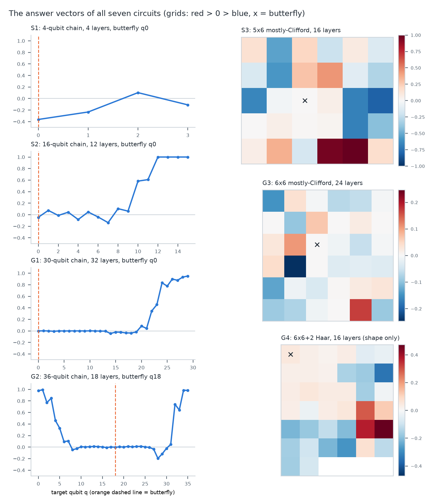
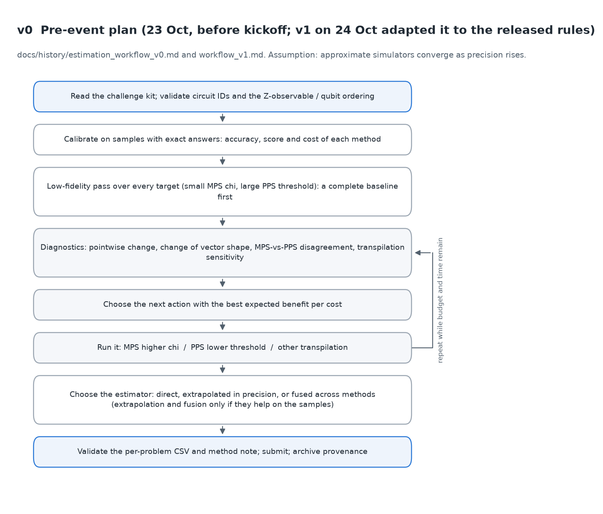
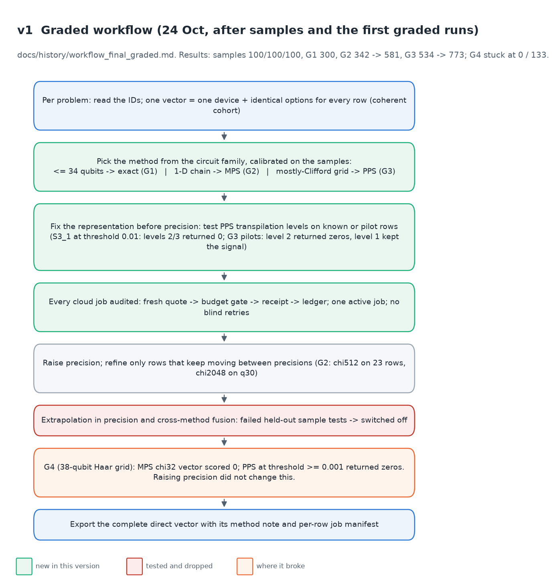
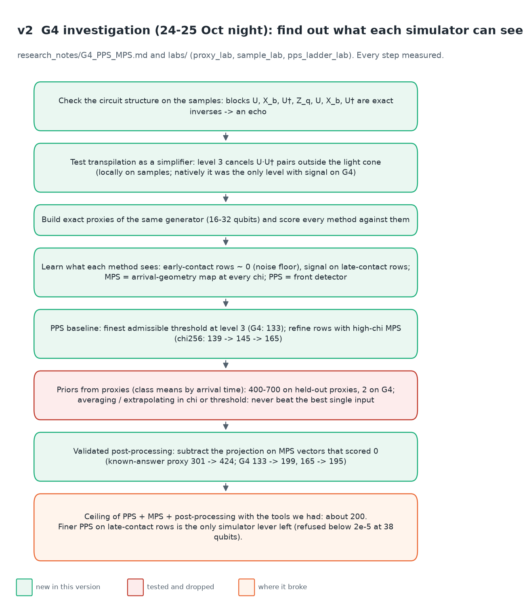
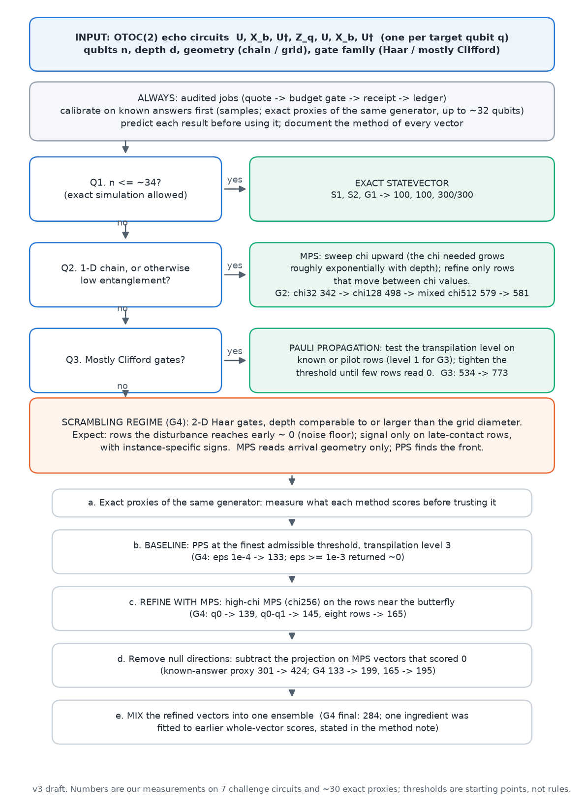
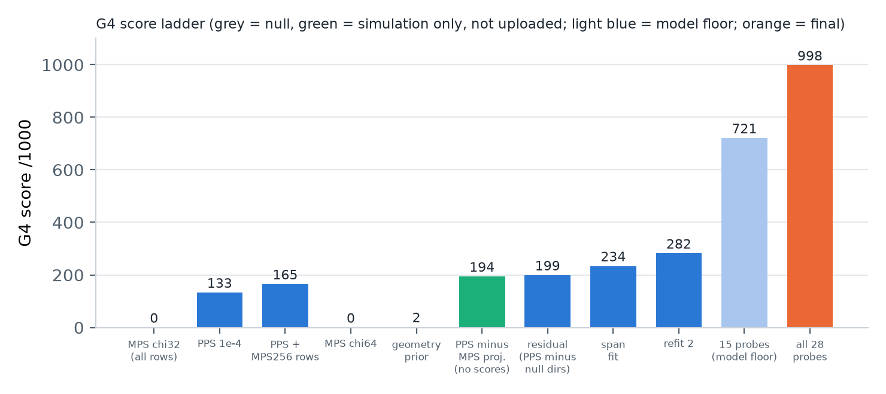

# A flowchart for estimating OTOC(2) circuits with MPS and Pauli propagation

How our estimation procedure changed during the BlueQubit Duke OTOC challenge, version by version,
and which parts we think are reusable. Written for people who run circuit simulations; the physics is
limited to what we measured. Every number below is in the repository; the G4 numbers are printed by
`python scripts/g4_pps_mps_summary.py`, and the figures are rebuilt by `python scripts/make_framework_figures.py`.

## 1. The problem

Each problem is a set of hidden circuits `U, X_b, U†, Z_q, U, X_b, U†` (an echo: the butterfly kick
`X_b` is scrambled by `U` and undone twice), one per target qubit `q`; the answer is `⟨Z_q⟩`. Without
scrambling it is exactly +1; how far it falls says how far the kick spread. Circuits run only by ID on
BlueQubit's simulators: exact up to 34 qubits, MPS (bond dimension χ) and Pauli propagation (PPS; threshold
ε, transpilation level).

| Problem | Circuit | Method of the scored vector | Score |
| --- | --- | --- | ---: |
| S1, S2, S3 | 4- and 16-qubit chains; 30-qubit mostly-Clifford grid | exact; exact; PPS (local) | 100 each |
| G1 | 30-qubit Haar chain, 32 layers | exact CPU statevector | 300/300 |
| G2 | 36-qubit Haar chain, 18 layers, central butterfly | MPS, higher χ on rows that moved | 581/600 (reported) |
| G3 | 36-qubit mostly-Clifford 6×6 grid, 24 layers | PPS, level 1, ε 0.0003 | 773/800 (reported) |
| G4 | 38-qubit Haar 6×6+2 grid, 16 layers | PPS baseline, MPS-refined rows, null directions removed, ensemble | 284/1000 |

Provenance of each score: [docs/results.md](docs/results.md).

## 2. What the vectors look like

Every vector is a scrambling front. Rows the kick reaches early are scrambled to ~0 (G1 q0–q19, the middle
of G2). Rows reached late or never keep memory: S2's last four answers are exactly 1, as the light cone
predicts, and both ends of G2 are ~0.98 because its butterfly sits in the middle. Mostly-Clifford circuits
keep the measured operator compact, so S3 and G3 have large, patterned values. In G4 every row is
eventually reached; the late rows are only partly scrambled and carry small values with instance-specific
signs (the G4 panel shows our final estimate, not the reference). Circuit drawings (real gates for S1,
reconstructed gate patterns for the hidden graded circuits) are in [reports/figures/circuits/](reports/figures/circuits/).

## 3. How the flowchart evolved

Each version was changed only when a measurement forced it.

**v0, before kickoff** ([docs/history/estimation_workflow_v0.md](docs/history/estimation_workflow_v0.md),
commit `8fac5d9`, 23 Oct): calibrate on the samples, make a low-fidelity pass over every row, then loop
"raise χ / lower ε" while watching convergence and MPS–PPS agreement, and extrapolate or fuse if the samples
support it. Assumption: approximations converge as precision rises.

**v1, the graded workflow** (24 Oct): choose the method by circuit family (exact ≤ 34 qubits, MPS for
chains, PPS for mostly-Clifford grids); test the representation before tightening precision (on S3_1 at
ε 0.01, transpilation levels 2/3 erased the signal; on G3, level 2 returned zeros and level 1 kept it);
refine only rows that keep moving (G2 342 → 498 → 579 → 581; G3 534 → 773); audit every cloud job.
Extrapolation failed held-out sample tests (an S2 window fell from 99.9 to 96.0) and was switched off.
v1 broke on G4: MPS χ32 and χ64 scored 0, and raising precision changed nothing.

**v2, the G4 investigation** (24–25 Oct night): stop raising precision and find out what each simulator
can see, using exact proxies built like G4 (16–32 qubits, including a 32-qubit circuit, PG4c, with native
runs and an exact reference). Rows reached early sit at the `2^(-n/2)` noise floor. MPS at every χ is biased
toward +1 on the rows the kick reaches late (the truncated echo undoes itself too well), so it scores at the
null. PPS at transpilation level 3, which cancels `U·U†` pairs outside the light cone, is the only setting
that returned signal on G4 (level 1/2 and ε ≥ 1e-3 gave zeros); at ε 1e-4 it scored 133 and became the
baseline. MPS χ256 on rows near the butterfly refined it to 165. Priors learned on proxies scored 400–700
there and 2 on G4, so they were dropped. One post-processing rule held on both: subtracting PPS's
projection on the MPS vectors (known-answer proxy 301 → 424; G4 133 → 199, using only the fact that the MPS
vectors scored 0).

**v3, generalized** (25 Oct): the decision chart we would hand to the next team. The three questions
(size, chain, mostly Clifford) are the routes that solved G1–G3; the scrambling-regime branch is the
G4 workflow: PPS baseline → MPS refinement → remove null directions → mix the refined vectors.

## 4. G4: PPS baseline, MPS refinement, ensemble (0 → 284)

- **MPS alone: 0.** χ32 and χ64 vectors agree in shape (ρ ≈ 0.96) and both score 0: two unconverged
  cohorts sharing the same bias.
- **PPS baseline: 133.** ε 1e-4, transpilation level 3, all 38 rows. Native calibration on sample rows with
  exact answers showed PPS accuracy is not monotonic in ε, so the baseline is the finest affordable ε at
  the only level that kept signal.
- **MPS refinement: 139 → 145 → 165.** MPS χ256 values replace PPS on q0, then q0–q1, then q0–q3 and q6–q9.
- **Remove null directions: 199 / 195.** The χ32, χ64 and geometry-prior vectors scored 0, 0 and 2, so they
  carry no reference signal; regressing them out of the 133 and 165 vectors keeps the signal and drops the
  rest. Validated first on PG4c's exact answer (301 → 424).
- **Ensemble: 284.** A teammate mixed refined vectors into the final file. Its dominant ingredient was a
  refinement vector fitted to the website scores of earlier whole-vector uploads, not a simulator output;
  the method note says so.

Details, run table and what did not help: [research_notes/G4_PPS_MPS.md](research_notes/G4_PPS_MPS.md).

## 5. What we think is reusable

- Route by size, geometry and gate family before tuning any precision knob.
- Test the representation (transpilation level) on known or pilot rows before tightening the threshold.
- Spend precision only on rows that move between precision levels.
- Recognise the scrambling regime (2-D, random gates, depth comparable to the grid diameter): the bulk is
  noise, and MPS supplies geometry rather than values. Start from PPS at level 3 and the finest affordable
  ε, refine with high-χ MPS only on rows near the butterfly, and treat MPS vectors that score 0 as
  directions to subtract.
- Keep only post-processing that holds on a known answer (exact proxies of the same generator are cheap
  to build up to ~32 qubits).
- Agreement between two precision levels of the same method is not evidence of accuracy.

## 6. Limits

The flowchart rests on seven challenge circuits and about thirty exact proxies; its thresholds are starting
points. G4 is one 38-qubit instance; simulation and validated post-processing reached 199, and the final 284
depends on an ingredient fitted to website scores. The next simulator step, PPS at ε 3e-5 on G4's 22
late-contact rows, was not run. Some G2/G3 scores are reported from teammates' accounts or commit messages.
