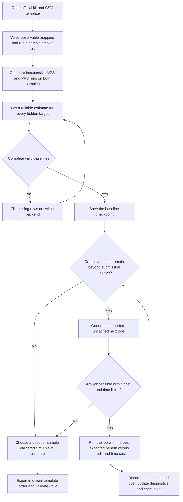

# BlueQubit OTOC estimation

This repository follows the [preliminary workflow](estimation_workflow_v0.md). The official challenge kit and its CSV template control circuit IDs, observables, scoring, and submission details. The kit adapter and adaptive scheduler are still planned. Packaging, machine-readable run records, template validation, and protected baseline checkpoints are implemented.

## Repository layout

| Location | Purpose |
| --- | --- |
| `kit/` | Original official release files when available; keep them unchanged. |
| `config/` | Future budget, precision-grid, backend, and fallback settings. Empty skeleton. |
| `src/otoc/` | Client setup, template validation, checkpoints, and CSV run-record helpers. Kit adapter, diagnostics, scoring, and scheduler remain to be added. |
| `data/samples/` | Derived sample data and benchmarks; retain the original kit files in `kit/`. Empty skeleton. |
| `data/checkpoints/` | Recoverable complete prediction vectors, beginning with a valid baseline. Empty skeleton. |
| `runs/` | Six optional human workbooks, [machine-readable CSV records](runs/csv/README.md), and a [quick guide](runs/README.md). |
| `scripts/` | Live [smoke test](scripts/smoke_test.py), workbook [CSV exporter](scripts/export_submission.py), [run-record CLI](scripts/run_csv.py), and [checkpoint validator](scripts/checkpoint_submission.py). |
| `reports/`, `research_notes/`, `papers/`, `docs/` | Analysis and reference material already in the repository. |
| `submissions/` | Validated CSV output; `scratch/` is ignored temporary work. |

Empty skeleton directories are local placeholders until populated; Git does not track empty directories.

Keep API credentials in the ignored `.env` or environment variables; never put them in run records or submissions.

## Kit-ready local workflow

Install from the repository root with `pip install -r requirements.txt`. The package is defined in `pyproject.toml`; this makes `otoc.config.get_client` available to the smoke test. The smoke test submits live jobs, so run it only when you intend to use BlueQubit. Its multi-term PPS case is opt-in with `--include-multi-term`.

Once the kit supplies its templates, initialize CSV targets and blank selections:

```powershell
python scripts/run_csv.py init --dataset sample --template "PATH_TO_SAMPLE_TEMPLATE.csv"
python scripts/run_csv.py init --dataset hidden --template "PATH_TO_HIDDEN_TEMPLATE.csv"
python scripts/run_csv.py validate
```

Record jobs, returned estimates, and chosen predictions through `scripts/run_csv.py` as described in [runs/csv/README.md](runs/csv/README.md). After selecting a complete direct baseline in `runs/csv/selected_hidden.csv`, validate and protect it:

```powershell
python scripts/checkpoint_submission.py --template "PATH_TO_HIDDEN_TEMPLATE.csv" --estimates runs/csv/selected_hidden.csv --check-only
python scripts/checkpoint_submission.py --template "PATH_TO_HIDDEN_TEMPLATE.csv" --estimates runs/csv/selected_hidden.csv --kind baseline
```

The command writes `data/checkpoints/baseline.csv` in the official template order. It rejects missing, extra, duplicate, nonnumeric, and nonfinite estimates. An existing baseline with different values cannot be replaced; later candidates can use `--kind latest`.

## Workflow decision tree



The allocation loop compares the **next** useful jobs across all circuits. It first protects a complete, submit-ready baseline, then spends remaining resources where sample evidence and recent precision trends suggest the largest gain. Rank and bill at the platform's actual job granularity: a whole-circuit run is one action even if it returns many qubits. See [Section 6](estimation_workflow_v0.md#6-adaptive-computational-resource-allocation) for the provisional priority formula and stopping rules.
