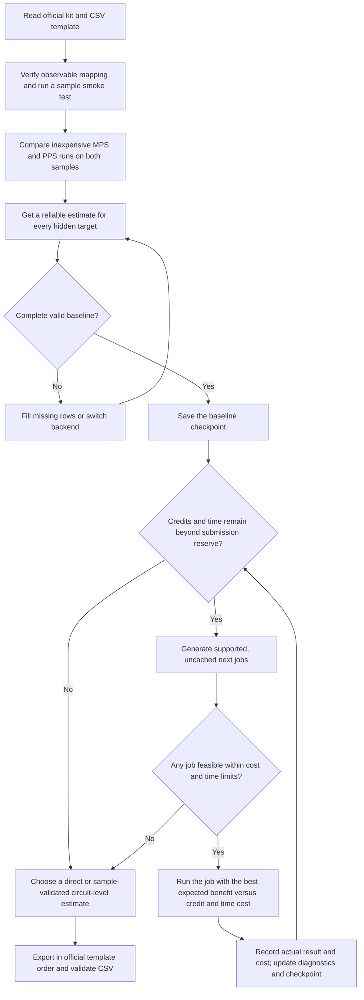

# BlueQubit OTOC estimation

This repository follows the [preliminary workflow](estimation_workflow_v0.md). The official challenge kit and its CSV template control circuit IDs, observables, scoring, and submission details. The scheduler and kit adapter described below are planned; they are not implemented yet.

## Repository layout

| Location | Purpose |
| --- | --- |
| `kit/` | Original official release files when available; keep them unchanged. |
| `config/` | Future budget, precision-grid, backend, and fallback settings. Empty skeleton. |
| `src/` | Future kit adapter, result store, sweeps, diagnostics, scheduler, scoring, and estimator selection. Empty skeleton. |
| `data/samples/` | Derived sample data and benchmarks; retain the original kit files in `kit/`. Empty skeleton. |
| `data/checkpoints/` | Recoverable complete prediction vectors, beginning with a valid baseline. Empty skeleton. |
| `runs/` | Six circuit workbooks and a [quick guide](runs/README.md). |
| `scripts/` | Existing [smoke test](scripts/smoke_test.py) and [CSV exporter](scripts/export_submission.py). |
| `reports/`, `research_notes/`, `papers/`, `docs/` | Analysis and reference material already in the repository. |
| `submissions/` | Validated CSV output; `scratch/` is ignored temporary work. |

Empty skeleton directories are local placeholders until populated; Git does not track empty directories.

Keep API credentials in the ignored `.env` or environment variables; never put them in run records or submissions.

## Workflow decision tree

The allocation loop compares the **next** useful jobs across all circuits. It first protects a complete, submit-ready baseline, then spends remaining resources where sample evidence and recent precision trends suggest the largest gain. Rank and bill at the platform's actual job granularity: a whole-circuit run is one action even if it returns many qubits. See [Section 6](estimation_workflow_v0.md#6-adaptive-computational-resource-allocation) for the provisional priority formula and stopping rules.
