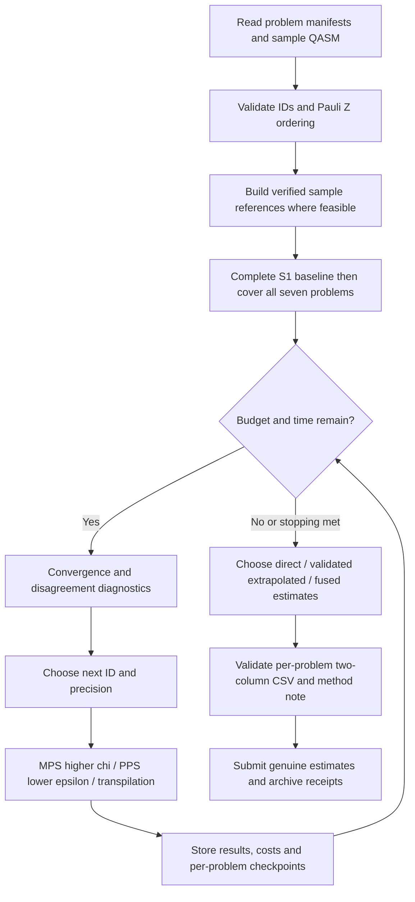

# BlueQubit OTOC Challenge: Multi-Fidelity Estimation and Adaptive Computation Algorithms

> **Technical Design Document · Version 1.1 (Official Challenge Update; Awaiting Implementation)**  
> **Created: 2026-10-22; rules reviewed: 2026-10-24**  
> **Event: DuQuantum 2026 / BlueQubit Quantum Simulation Challenge**  
> **Core task:** Estimate Pauli-Z expectations for the independent per-qubit programs of seven circuits, S1–S3 and G1–G4. Hidden circuits may be executed only through BlueQubit circuit IDs.  
> **Status:** Updated against the live official Overview and Rules. This remains an algorithm specification awaiting implementation, not a record of executed or verified experiments. The Problems tab was not yet open during this review, so official QASM files, per-problem ID lists, and account quotas have not been downloaded or verified; read them after kickoff.

---

## Executive Summary

**Core approach:** Use MPS sweeps over multiple bond dimensions and Pauli-path simulation (PPS) sweeps over multiple truncation thresholds as the two main branches. Decide whether to use extrapolation based on sample validation, and add vector-level convergence diagnostics, transpilation sensitivity analysis, cross-method consistency checks, adaptive computational budget allocation, and rigorously validated estimator fusion.

The overall closed-loop workflow is:

1. **Calibration:** Build references with provenance from the public QASM for S1–S3. Use only verified exact references for absolute errors and offline score calibration; official answers are hidden.
2. **Low-fidelity sweep:** Produce complete predictions for each of the seven problems. Complete the S1 workflow first, then cover G1–G4; samples also contribute points.
3. **Multi-fidelity refinement:** Increase MPS $\chi$ and PPS accuracy (by decreasing $\epsilon$), respectively; attempt extrapolation when sample validation supports it.
4. **Uncertainty diagnostics:** Examine pointwise changes, changes in the shape of the full OTOC vector, disagreement between methods, and transpilation sensitivity.
5. **Adaptive scheduling:** Prioritize the next simulation with the greatest expected benefit per unit cost, updating results continuously.
6. **Estimator selection & submission:** Compare direct, extrapolated, and fused estimates; validate a two-column CSV and method note per problem, retaining each problem's best submission and tracking its limit of 20 attempts.

**Default policy:** *Prioritize the most trustworthy direct estimate. Extrapolation and fusion must demonstrate benefits on the samples. A smooth-looking convergence curve is not sufficient evidence that its limiting value is correct.*

**Minimum viable product (MVP):** Data ingestion and caching + MPS/PPS baselines + numerical and vector-level convergence checks + budget scheduling + a valid CSV. Transpilation ensembles, learned calibration, and complex extrapolation are optional enhancements.

---

## 1. Problem Definition & Objectives

### 1.1 Challenge description

The [official BlueQubit Overview](https://app.bluequbit.io/hackathons/2GMaAenu3iSsIC6Z) and [Rules](https://app.bluequbit.io/hackathons/2GMaAenu3iSsIC6Z?tab=rules), reviewed on 2026-10-24, specify:

| Item | Current official description |
|---|---|
| Problems and size | **7 problems**: **50 values** across S1–S3 and **140 values** across G1–G4, totaling **190**; read per-problem qubit counts from the released problems |
| Samples | **3 public circuits, S1–S3**, with a separate OpenQASM 2.0 file per ID; other simulation tools are allowed; **all official answers are hidden** |
| Hidden circuits | **G1–G4**, executable only by ID through the platform/SDK; gate sequences are unavailable for download |
| Target | Run the program `Duke_<circuit>_<q>` from the all-zero state and estimate Pauli Z on QASM qubit `q[q]`, with physical range $[-1,1]$ |
| Points | **100** each for S1/S2/S3; **300/600/800/1000** for G1/G2/G3/G4; **3000** total |
| Scoring | Squared positive Pearson correlation times problem points; negative correlation and constant predictions score **0**, as defined in §1.2 |
| Submission | **One two-column CSV per problem**: `circuit_id,value`; optional header, arbitrary row order, case-sensitive IDs; include a short method note |
| Attempts and ranking | At most **20 submissions per problem**, best score retained; missing/wrong IDs are rejected during upload prechecks without using an attempt; ties use the sum of time penalties for each problem's best submission, with lower totals preferred |
| Schedule | 2026-10-24 11:30 AM ET to 2026-10-25 11:30 AM ET; **10:30 AM CDT** on both dates in America/Chicago |
| Compute allowance | **\$30** of event credits per online participant or in-person team; coupon `UOECJBRJDA`, redeemed under Account → Billing → Redeem Coupon; consult usage for charges and available time |
| Participation | Individual participation online; up to **4 people** sharing one account for in-person Duke teams |

Download sample ZIPs from Problems 1–3. Files are named `<ID>.qasm`, use the gates `u3, cz, x, z`, and contain no measurements. **Different IDs represent different programs**; simulating one sample file and measuring all its qubits does not replace the other IDs.

The published integration uses **Python 3.11+, `bluequbit>=0.19.0b1`, `bq.get_circuit_info()`, and `bq.run()`**. Dependencies on `challenge_tools.otoc2_circuit`, `challenge_tools.score_csv`, and kit-supplied exact labels from the old design have been removed; do not assume these files or functions exist.

### 1.2 Mathematical notation

Let $c\in\mathcal C=\{S1,S2,S3,G1,G2,G3,G4\}$, $q\in\mathcal Q_c=\{0,\ldots,n_c-1\}$, and let $U_{c,q}$ be the independent program for ID `Duke_<c>_<q>`. The exact target is now specified:

$$
F^*_{c,q}=\langle 0^{n_c}|U_{c,q}^{\dagger} Z_q U_{c,q}|0^{n_c}\rangle\in[-1,1].
$$

$Z_q$ acts on the QASM register's `q[q]`. In SDK Pauli strings, **q0 is the rightmost position**:

$$
Z_q\longleftrightarrow I^{\otimes(n_c-1-q)}\otimes Z\otimes I^{\otimes q}.
$$

Construct it in Python as `"I" * (n - 1 - q) + "Z" + "I" * q`. Pass `pauli_sum=[(z, 1.0)]` for that ID and read `job.expectation_value`; do not construct an additional echo or change qubit ordering.

Define each problem's output vector and Pearson correlation as:

$$
\mathbf F_c^*=(F^*_{c,q})_{q\in\mathcal Q_c},\qquad
\rho_c(\mathbf x,\mathbf y)=
\frac{\langle\mathbf x-\bar x\mathbf 1,\mathbf y-\bar y\mathbf 1\rangle}
{\|\mathbf x-\bar x\mathbf 1\|_2\,\|\mathbf y-\bar y\mathbf 1\|_2}.
$$

The currently published scoring rule is:

$$
s_c(\mathbf x,\mathbf y)=
\begin{cases}
0,&\mathbf x\text{ is constant},\\
\big[\max(0,\rho_c(\mathbf x,\mathbf y))\big]^2,&\text{otherwise},
\end{cases}
\qquad
S_{\rm official}=\sum_{c\in\mathcal C}w_c\,s_c(\hat{\mathbf F}_c,\mathbf F_c^*),
$$

$$
(w_{S1},w_{S2},w_{S3},w_{G1},w_{G2},w_{G3},w_{G4})=(100,100,100,300,600,800,1000).
$$

Here, $w_c$ is the published point value and $s_c$ is the normalized score. Positive scaling and a common offset preserve correlation; **an overall sign flip changes its sign, and negative correlation scores 0**. This agrees with both the live Overview and Rules; prefer the live rules if a cached page says sign flips preserve the score. Protect nearly constant vectors using a numerical tolerance, without presenting that local tolerance as an official threshold. If a reference vector is constant and Pearson is undefined, flag the score as unavailable and check the official scorer rather than inventing its behavior.

Official sample answers are hidden too. Compute offline scores and MAE/RMSE only after independently producing and verifying exact references from public QASM; otherwise record official scores for genuine estimates and label-free diagnostics. Leaderboard feedback **must not** be used to recover labels, construct testing submissions, or fit hidden answers.

### 1.3 Optimization objectives & constraints

- **Primary:** Maximize the total over all seven problems within the \$30 event allowance and deadline; the samples' 300 points are part of the objective.
- **Secondary:** Reduce errors against verifiable references, improve cross-method consistency, and reduce failed jobs, duplicate charges, and invalid submissions.
- **Hard constraints:** Execute G1–G4 only through BlueQubit IDs. Use one participant/team account for all platform use and submissions; do not expand the event budget using external credits, other accounts, or other teams' resources. Submissions must be genuine estimates produced during the event; testing answers through scoring feedback is prohibited.
- **Tools:** Public QASM may be studied with other standard tools. Under Rules §6, organizers may decline to credit solutions relying on resources such as private clusters or unreleased internal code. Commercial AI assistants and standard simulators are allowed.
- **Operational constraints:** Measure API limits, queues, job costs, and available machine hours; include Hybrid machine time and paid jobs in spending. Official scoring and final rules take precedence.

Formally, policy $\pi$ chooses the next ID, simulator, and precision setting:

$$
\max_{\pi}\ \mathbb E[S_{\rm official}(\hat{\mathbf F}^{\pi})]
\quad\text{s.t.}\quad C(\pi)\le B_{\rm event},\quad
T(\pi)\le T_{\rm deadline},\quad N_{{\rm submit},c}\le20.
$$

$B_{\rm event}$ is the event allowance, $C$ includes applicable machine-time and job charges, $T$ is elapsed wall time, and $N_{{\rm submit},c}$ counts used submissions for problem $c$. Actual gains still require estimates from sample references with provenance and an online cost model.

### 1.4 Confirmed capabilities vs. conditional extensions

| Capability | Current status | Design treatment |
|---|---|---|
| Per-qubit IDs and basic calls | Official examples specify `Duke_<c>_<q>`, `get_circuit_info`, and `run` | Schedule per ID by default; metadata queries are free |
| Devices | Official list: `cpu`, `gpu`, `mps.cpu`, `mps.gpu`, `pauli-path` | Use these names; do not invent PPS device variants |
| MPS bond limit | SDK docs list `mps_bond_dimension` | Main branch; smoke-test the parameter in the required SDK version |
| PPS threshold | SDK docs specify minimum `1e-5` and an explicit threshold above 13 qubits | Keep the lower bound; verify the installed version |
| PPS transpilation | SDK docs support 0/1/2/3, default 2 | Optional enhancement; test acceptance and effect when running by ID |
| Exact sample labels | **Not public** | Build verifiable references from each ID's public QASM; do not assume packaged answers |
| Scoring, points, CSV format | Officially specified | Implement a local scoring replica, per-problem ID validation, and a submission ledger |
| Multiple IDs per job/batch and state reuse across IDs | **[To be confirmed]** | Treat programs as independent until verified; batching does not imply shared states |
| Per-problem $n_c$, ZIPs, and complete ID lists | Problems were not open during this review | Download, cross-check, and hash after kickoff; do not infer their distribution from totals |
| Concurrency, failure charges, exact-device quotas | Account usage and actual jobs determine these | Measure on a small scale; do not expand the event budget without authorization |

The public SDK reference still identifies itself as **0.18.12b1**, while the challenge requires **>=0.19.0b1**. General parameter documentation does not replace checks of the installed version, per-ID behavior, and returned fields.

### 1.5 Changes from Version 1.0

This revision replaces two labeled samples with three scored samples having public QASM and hidden answers; replaces unknown scoring with squared positive correlation and fixed points; replaces the combined three-column CSV with per-problem two-column files; and adopts the published SDK calls by ID. LOCO, fusion validation, budgeting, submission tracking, and acceptance criteria are revised accordingly. The core MPS/PPS multi-fidelity and conservative extrapolation design is retained.

---

## 2. Overall Algorithm Framework

### 2.1 High-level pipeline



**Core principle:** Cover every ID within a problem before refining its precision. A completed problem can be submitted independently without waiting for all 190 values. Establish a trustworthy baseline before trying complex models.

### 2.2 Functional modules

| Module | Input | Output | Responsibility |
|---|---|---|---|
| `ChallengeAdapter` | `(c, q, method, options)` | job/result | Encapsulate SDK execution by ID and Pauli-Z construction |
| `ExperimentStore` | job metadata/result | normalized records | Cache, deduplicate, and track computation and costs |
| `SampleEvaluator` | sample QASM + verified references, if available | score/error/cost report | Calibrate when references exist; otherwise report label-free diagnostics |
| `MPSAnalyzer` | $F(\chi)$ series | direct + optional extrapolation | Evaluate MPS convergence |
| `PPSAnalyzer` | $F(\epsilon,\ell)$ series | direct + optional extrapolation | Evaluate PPS convergence and transpilation sensitivity |
| `UncertaintyEngine` | Results from each branch | diagnostics / proxy uncertainty | Identify jobs requiring refinement |
| `BudgetScheduler` | uncertainty, weights, costs | next actions | Schedule online under both budget constraints |
| `EstimatorSelector` | candidate predictions + sample evaluations | best prediction per circuit | Select/fuse outputs |
| `SubmissionValidator` | per-problem ID manifest + predictions | valid two-column CSV | Check problem membership, ID sets, finite values, and attempt limits |

### 2.3 Data flow and invariants

1. Treat each released problem's ID list as authoritative. Cross-check `Duke_<c>_<q>` against $n_c$ from `get_circuit_info`; do not infer per-problem row counts from the 50/140 totals.
2. Store each ID's method, parameters, Pauli string, job ID, SDK version, runtime, estimated/actual costs, and status; also retain sample QASM hashes and reference provenance.
3. Centering, scaling, fusion, and clipping create separate estimator versions without overwriting raw outputs. Save each problem's CSV hash, method note, official score, and submission receipt.
4. Distinguish `EXACT_VERIFIED / APPROX_REFERENCE / UNAVAILABLE` references. Official answers remain hidden; agreement between approximations does not establish exact labels, and score feedback cannot be used to reconstruct answers.
5. Deduplicate by `(circuit_id, method, options, observable, sdk_version)` and check running jobs. Track `attempts_used`, `best_score`, and `best_submission_time` per problem.

---

## 3. Sample-Based Calibration & Initial Benchmarking

### 3.1 Bootstrapping

At startup, proceed in this order:

1. After kickoff, read the ID lists and descriptions for Problems 1–7 and download the S1–S3 ZIPs. Record download times, filenames, and SHA-256 hashes; verify that every ID has its own QASM.
2. Confirm Python 3.11+ and SDK >=0.19.0b1. Query dimensions with the free `bq.get_circuit_info("Duke_S1_0")` call and build per-problem manifests.
3. Choose an affordable S1 ID and smoke-test *all-zero state → run that ID → measure the corresponding Z → store result → two-column CSV*. SDK Pauli strings put q0 on the right; do not construct another echo.
4. Independently compute references from public QASM using an affordable standard local exact simulator or platform exact backend. Verify initial state, qubit order, operator, numerical tolerance, and provenance before assigning `EXACT_VERIFIED`; partial references do not constitute a complete problem reference.
5. Complete a first end-to-end submission using genuine S1 estimates and record the score and receipt; samples also count toward ranking. Without exact references, use convergence/cross-method diagnostics rather than claiming MAE/RMSE against ground truth.
6. Start small MPS/PPS precision sweeps, comparing candidates against local references first. Do not upload every candidate or construct submissions to check scoring behavior.

### 3.2 Initial parameter grids

These are **initial candidates** only, not official recommendations, and not every configuration needs to be run:

| Method | Initial candidates | Refinement strategy |
|---|---|---|
| MPS | $\chi\in\{32,64,128,256\}$ | Increase from low to high; stop on timeout or insert intermediate points |
| PPS | $\epsilon\in\{10^{-2},3\times10^{-3},10^{-3},3\times10^{-4},10^{-4}\}$ | Progress from coarse to fine; continue to $10^{-5}$ only if beneficial |
| PPS transpilation | Default to $\ell=2$; test $0/1/3$ | First compare stability and cost at the same $\epsilon$ |
| Exact | Affordable samples only | For validation; do not assume all hidden circuits can be simulated exactly |

Actual PPS thresholds below `1e-5` are outside the scope supported by the current documentation. For PPS circuits with more than 13 qubits, the current SDK documentation requires an explicit threshold.

### 3.3 Accuracy–cost benchmark

Compute the following errors for sample circuit $s$ and estimator $m$ only against `EXACT_VERIFIED` references. If references cover only some IDs, report that subset and its coverage rather than claiming whole-problem errors:

Let $\varnothing\ne\mathcal R_s\subseteq\mathcal Q_s$ be the IDs with verified references. Coverage is $|\mathcal R_s|/n_s$, where $n_s=|\mathcal Q_s|$:

$$
\operatorname{MAE}_{s,m}=\frac1{|\mathcal R_s|}\sum_{q\in\mathcal R_s}|\hat F^{(m)}_{s,q}-F^*_{s,q}|,
\qquad
\operatorname{RMSE}_{s,m}=\sqrt{\frac1{|\mathcal R_s|}\sum_{q\in\mathcal R_s}(\hat F^{(m)}_{s,q}-F^*_{s,q})^2}.
$$

Also record:

- **Score:** Apply the local formula in §1.2 to complete verified references, and record platform scores for genuine submissions separately. An unsubmitted candidate is not officially verified.
- **Pearson / Spearman correlation:** Support analysis of vector shape and rank consistency.
- **Runtime:** Wall time from submission to completion, backend compute time (if available), and queue time (if available).
- **Cost:** Actual credits consumed, tracked separately from wall time.
- **Failure rate:** Timeouts, OOM events, canceled jobs, and API errors.
- **Completeness:** Fraction of required rows covered by the current estimates.

### 3.4 Validation discipline

- There are only **3 sample circuits, S1–S3**. Their qubits correspond to different programs, but do not constitute independent samples of generalization across circuit families.
- When all three samples have complete, verified exact references, perform **3-fold leave-one-circuit-out (LOCO)**: select on two circuits and validate on the third, rotating through all three. Report each fold and the worst problem result.
- With references for only some samples, report only feasible validation. Unlabeled samples cannot serve as supervised test sets. If references are insufficient, do not claim LOCO passed; retain the direct baseline and disable learned calibration.
- Avoid repeatedly fitting many parameters on a few samples. Retain a direct simulation baseline **without extrapolation or fusion** for every candidate strategy.
- Use immediate platform scores to record the performance of genuine solutions only. Respect the 20-attempt limit and anti-testing rules; the leaderboard is not a label oracle or a training signal for hidden answers.

### 3.5 Benchmark acceptance gate

Before large-scale refinement of hidden targets, establish:

- What is each sample's reference status, coverage, and numerical provenance?
- Which backend lies on the better verified-reference score / actual-cost Pareto frontier? Without references, stability assessments require explicit limitations.
- Where do increasing $\chi$ / decreasing $\epsilon$ cease to improve scores or convergence diagnostics materially?
- Do conclusions transfer across S1–S3, and which folds are unevaluable because references are missing?
- Have parameters, per-ID execution, actual device charges, and the first S1 two-column CSV workflow been verified?

---

## 4. Multi-Fidelity OTOC Estimation

### 4.1 MPS-based estimation

For each target index that may be computed, define:

$$
F^M_{c,q}(\chi)=\text{MPS estimate with bond limit }\chi.
$$

Run simulations with increasing $\chi_1<\cdots<\chi_K$. Diagnose changes between adjacent points:

$$
\Delta^M_{c,q,k}=|F^M_{c,q}(\chi_k)-F^M_{c,q}(\chi_{k-1})|.
$$

**Candidate extrapolation model:**

$$
F^M_{c,q}(\chi)\approx F^M_{c,q,\infty}+a_{c,q}\chi^{-p},\qquad p>0.
$$

This is an empirical fit only. MPS expectation values at finite bond dimension **are not guaranteed** to follow a fixed power law, nor is their error guaranteed to be monotonic. Implement two types of estimator:

1. **Direct:** The raw output at the highest trustworthy $\chi$ (must be retained).
2. **Extrapolated:** Enable only when enough precision points are available, the fit is stable, and extrapolation is effective on the samples.

Suggested extrapolation validation: fit the coarser points and predict a held-out finer point; compare against simply using the last coarse point directly. If the next precision point cannot be predicted reliably, do not use the more distant $\chi\to\infty$ extrapolation.

**Reject extrapolation if any of the following applies:**

- Too few points are available to distinguish a plateau from a fitted trend;
- The fitted $p$ or $F_\infty$ is highly sensitive to removing a data point;
- The curve is clearly nonmonotonic and different fitting windows yield conflicting limits;
- The inferred extrapolation step is much larger than the numerical changes observed;
- The official sample score is below that of the best direct estimate.

**Fallback:** Use the best validated $\chi$ directly and record `extrapolation_rejected` in the metadata.

### 4.2 Pauli-path-based estimation

Define:

$$
F^P_{c,q}(\epsilon,\ell)=\text{PPS estimate with truncation threshold }\epsilon
\text{ and transpilation level }\ell.
$$

At fixed $\ell$, progressively reduce the threshold from a large value within the platform-supported range:

$$
\epsilon_1>\epsilon_2>\cdots\ge 10^{-5}.
$$

Candidate extrapolation form:

$$
F^P_{c,q}(\epsilon,\ell)
\approx F^P_{c,q,0}(\ell)+b_{c,q,\ell}\epsilon^r,\qquad r>0.
$$

**Special caution:** The current implementation discards terms according to an absolute-value threshold on Pauli coefficients during propagation. As $\epsilon$ crosses coefficient thresholds, results may be stepwise, nonsmooth, or nonmonotonic. The mathematical limit $\epsilon\to0$ must not be treated as a reliable extrapolation from finitely sampled points.

Use **piecewise diagnostics**:

- Differences between adjacent estimates and relative changes;
- Checks for plateaus across several consecutive thresholds;
- Separate fits over different threshold subranges, with comparisons of result stability;
- Caution about plateaus within the feasible threshold range: **unchanged does not mean unbiased**; additional Pauli terms may simply not have been activated yet.

By default, use the direct result at the smallest **affordable** threshold; enable extrapolation only after sample validation succeeds.

### 4.3 Transpilation sensitivity / ensemble

When the interface permits it, test $\ell\in\{0,1,2,3\}$. Different transpilation representations may change PPS truncation behavior, runtime cost, and numerical bias.

For outputs at multiple levels with the same $\epsilon$, define:

$$
\bar F^P_{c,q}(\epsilon)=\frac1L\sum_{\ell\in\mathcal L}F^P_{c,q}(\epsilon,\ell),
$$

$$
\sigma^P_{\mathrm{trans},c,q}(\epsilon)
=\sqrt{\frac{1}{L-1}\sum_{\ell\in\mathcal L}
\left[F^P_{c,q}(\epsilon,\ell)-\bar F^P_{c,q}(\epsilon)\right]^2}.
$$

Here, $L\ge2$. **$\sigma_{\rm trans}$ measures representation sensitivity only; it is neither a standard deviation from independent random experiments nor an error bar with guaranteed coverage.** Averaging across levels is also not guaranteed to outperform the best level.

Recommendations:

1. Start with level 2, the default in the SDK documentation;
2. Compare actual score/cost for another 1–2 levels on the samples;
3. Add levels only for hidden targets where differences exist and may be useful;
4. Treat increasing agreement between levels as $\epsilon$ decreases as supplementary convergence evidence; if disagreement grows, reduce trust in that estimator.

### 4.4 Estimator selection within each branch

Retain candidate sets for each branch:

$$
\mathcal E_M=\{\text{highest-fidelity direct},\text{validated extrapolation}\},
$$

$$
\mathcal E_P=\{\text{highest-fidelity direct},\text{validated extrapolation},\text{validated level ensemble}\}.
$$

Selection should prioritize the samples' **official scores and robustness of generalization**, followed by fitting residuals or apparent parameter convergence. Avoid freely choosing among many estimators independently for each hidden qubit, which would introduce uncontrolled selection bias; prefer a small set of shared rules applied at the circuit level.

---

## 5. Convergence & Uncertainty Quantification

### 5.1 Pointwise convergence indicators

For estimates at two consecutive precision levels, define the absolute change:

$$
D^{\mathrm{point}}_{c,q,m,k}=\big|F^{(m)}_{c,q,k}-F^{(m)}_{c,q,k-1}\big|.
$$

To avoid division by an unstable quantity near zero, do not use the relative error $D/|F|$ alone. Define a robust scale:

$$
s_c=\max\left(\operatorname{MAD}(\hat{\mathbf F}_c),\ s_{\min}\right),
$$

Use $D/s_c$ as a **dimensionless heuristic feature**. Set $s_{\min}$ according to the scale of the samples; do not arbitrarily make it too small.

### 5.2 Vector-shape convergence

For the same circuit, center and normalize the vector:

$$
\mathbf z(\mathbf x)=\frac{\mathbf x-\bar x\mathbf 1}{\|\mathbf x-\bar x\mathbf 1\|_2},
$$

This requires the centered norm to be sufficiently large. Between vectors at adjacent precision levels:

$$
D^{\mathrm{shape}}_{c,m,k}
=1-\rho\!\left(\mathbf F^{(m)}_{c,k},\mathbf F^{(m)}_{c,k-1}\right).
$$

Also compute rank consistency, such as Spearman $\rho_S$, to determine whether the ordering is still changing.

**Important limitation:** If a vector is nearly constant, Pearson correlation / the normalized direction is extremely sensitive to small perturbations. In this case, stop relying on `D_shape` and use absolute RMS differences and the range of the raw estimates instead. Do not regard two nearly constant vectors as "high confidence."

For scoring dominated by correlation, distinguish the following cases:

- A substantial overall shift in values with almost unchanged centered shape: this may already suffice for a correlation-dominated score;
- Small changes in individual elements while rank/shape continues to change: further refinement is more meaningful;
- Stable shapes while both methods are wrong: trust may still be overstated, requiring sample calibration.

### 5.3 Cross-method consistency

Compare MPS and PPS outputs using:

$$
D^{\mathrm{cross}}_c=1-\rho(\hat{\mathbf F}^M_c,\hat{\mathbf F}^P_c),
$$

and the raw pointwise disagreement:

$$
d^{\mathrm{cross}}_{c,q}=|\hat F^M_{c,q}-\hat F^P_{c,q}|.
$$

These measure different aspects: the former primarily concerns shape, while the latter includes offset/scale differences. If the algorithms produce outputs on different scales, also record the pointwise differences after centering and normalization, $|z_{M,q}-z_{P,q}|$.

**This does not imply that the true value lies between the two estimates.** MPS and PPS may have systematic biases in the same direction, especially in the scrambling regime of deep circuits.

### 5.4 Heuristic uncertainty indicator

Construct a feature vector:

$$
\boldsymbol\phi_{c,q}=(d^M_{\rm step},d^P_{\rm step},d_{\rm cross},d_{\rm trans},d_{\rm shape,c},r_{\rm cost},\ldots).
$$

First account for the units and scales of all quantities. Define:

$$
U_{c,q}=g_{\rm conservative}(\boldsymbol\phi_{c,q})\ge0.
$$

Initially use a nonnegative linear combination with fixed weights or the maximum across features. Calibrate only when verified exact sample errors are available; otherwise label it an uncalibrated heuristic. Do not train a neural uncertainty model.

**Interpretation limit:** $U$ is an *uncertainty proxy* for ranking, not a statistical probability such as $\Pr(|\hat F-F^*|<\delta)$. Terms such as "confidence interval" or "standard error" require an appropriate statistical model or validation of frequentist coverage.

### 5.5 Quality states and stopping signals

Each circuit may maintain one of four **internal engineering labels**, `LOW / MEDIUM / HIGH / UNSTABLE`. For example:

- `LOW`: Only a single low-fidelity estimate is available;
- `MEDIUM`: Changes between adjacent precision levels are shrinking for at least one method, and the output is valid;
- `HIGH`: Shapes are stable across precision levels within a parameter region that performs well on the samples, with support from an independent method or transpilation level;
- `UNSTABLE`: Increased precision causes unusually large changes, job failures, anomalous scales, or strong conflicts between methods.

These are **operational labels**, not scientific conclusions that guarantee accuracy.

---

## 6. Adaptive Computational Resource Allocation

### 6.1 Action space

Retain the action representation:

$$
a=(c,I,m,\lambda_m),
$$

Here, $c$ is the problem, $I\subseteq\mathcal Q_c$ identifies the qubit IDs to run, $m\in\{\mathrm{MPS},\mathrm{PPS}\}$, and $\lambda_m$ is $\chi$ or $(\epsilon,\ell)$.

- **Default mode:** Set $I=\{q\}$ and run `Duke_<c>_<q>` directly. Per-qubit programs are confirmed to be independent; record precision and charges for each ID.
- **Optional batch:** Bundle independent IDs only after verifying multi-ID requests and actual billing in the required SDK version. Batching may reduce request overhead; it does not establish shared simulation states or a single compute charge for multiple IDs.

Schedule across S1–S3 and G1–G4. Assemble vectors by each problem's manifest; a pooled correlation across different problems does not reproduce official per-problem scoring.

### 6.2 Initial low-fidelity pass

Obtain at least one valid prediction for every required submission row:

1. Use sample results to select inexpensive configurations for each method;
2. Obtain genuine baseline estimates for all seven problems; complete the S1 workflow first, then prioritize hidden-problem coverage while retaining scoring opportunities on S2/S3;
3. If a backend fails, automatically switch to the other backend or retain a previously successful result;
4. Save complete baseline checkpoints and two-column CSVs per problem; validate/submit completed problems without waiting for the others.

**Coverage takes priority over refinement.** If any rows remain uncovered near the deadline, prioritize filling them with valid results and suspend ensemble / extrapolation experiments.

### 6.3 Cost model

Maintain predictions for every candidate action:

$$
\hat C(a)=\text{estimated credits},\qquad
\hat T(a)=\text{estimated elapsed wall time}.
$$

Fit costs from the first small jobs using a robust median or conservative upper quantile. The event allowance is \$30; verify the redeemed balance, account for both Hybrid machine and job charges without double-counting, and do not expand the budget with external credits.

**Note:** The standard BlueQubit `BQClient.estimate()` documentation lists mainly statevector CPU/GPU devices; it does not promise accurate cost predictions directly for MPS/PPS or hidden challenge jobs. Do not rely on this function to cover every case. Actual billing / credit deductions take precedence.

Maintain:

$$
C_{\rm used}+\hat C(a)+C_{\rm reserve}\le B_{\rm total},
$$

and

$$
T_{\rm remaining}\ge\hat T(a)+T_{\rm submission\ buffer}.
$$

Check the two constraints independently; ample credits do not imply sufficient wall time.

### 6.4 Priority score

The ideal selection criterion, which cannot be computed directly, is:

$$
a^*=\arg\max_a\frac{\mathbb E[\Delta S_{\rm official}\mid a]}{\hat C(a)+\lambda_T\hat T(a)}.
$$

For a practical initial version, use:

$$
P(a)=\frac{\hat w_c\cdot \hat I(a)\cdot \hat R(a)}
{\hat C(a)+\lambda_T\hat T(a)+\delta},
$$

where:

- $\hat w_c=w_c$: Use the published points $(100,100,100,300,600,800,1000)$ for S1/S2/S3/G1/G2/G3/G4. Known points do not imply known gains from the next simulation.
- $\hat I(a)$: The aggregate uncertainty / shape influence of the affected observables.
- $\hat R(a)$: A factor assessing whether the next precision level is likely to improve results, based on recent gains from increased precision; use a conservative constant when evidence is absent.
- $\lambda_T$: A manually set coefficient that converts limited time into a penalty; $\delta>0$ prevents division by zero.

If an action computes a whole circuit, aggregate $\hat I(a)$ over the entire set $I$ rather than taking the maximum for a single qubit.

### 6.5 Greedy adaptive refinement

Use a greedy scheduler with low computational overhead and interpretable behavior:

1. Collect all *currently feasible* actions (the next $\chi$, the next $\epsilon$, and a new $\ell$ when necessary).
2. Compute predicted cost, time, gain proxy, and failure risk for each action.
3. Filter out over-budget actions, actions that clearly cannot finish in time, and duplicate jobs.
4. Choose the highest-priority action, or several nonconflicting actions to run concurrently (within the measured concurrency capacity of the interface).
5. After completion, update results, actual costs, and each $U_{c,q}$.
6. If a branch yields almost no gain over several consecutive refinements, temporarily reduce its priority; allow later evidence to reverse this decision.
7. Periodically reassess the global allocation to avoid exhausting the budget on the circuits started first.

### 6.6 Stopping criteria

Any of the following may trigger stopping for a circuit/method:

- The predicted benefit per cost of further precision increases is below that of other executable actions;
- Vector shapes are stable across several adjacent precision levels, and samples indicate little benefit from additional precision;
- Repeated timeouts/OOM events occur, or the next level is unlikely to finish before the deadline;
- The cost of an action exceeds the remaining nonreserved budget;
- Bias remains large but no longer improves with precision: mark as `UNSTABLE` and consider switching methods.

Global stopping is governed by **complete, valid predictions + budget exhaustion / the submission time buffer being reached**. Do not miss submission in pursuit of higher precision.

---

## 7. Multi-Fidelity Ensemble & Error Calibration

### 7.1 Direct estimator as the anchor

First establish a single-method anchor for each circuit, such as the highest trustworthy precision MPS or PPS vector from the method that performs better on the samples:

$$
\hat{\mathbf F}_{c,\mathrm{anchor}}.
$$

Report every fusion scheme's gain relative to the anchor. Supervised offline LOCO requires complete verified sample references. Revert to the anchor when references are insufficient or gains are inconsistent; repeated uploads do not replace validation.

### 7.2 Raw-value fusion

The simplest scheme is:

$$
\hat{\mathbf F}_{c,\mathrm{mix}}
=w\hat{\mathbf F}^{M}_c+(1-w)\hat{\mathbf F}^{P}_c,\quad w\in[0,1].
$$

Test a small shared grid, such as $w\in\{0,0.25,0.5,0.75,1\}$. Three samples still do not support many free parameters.

Run 3-fold LOCO on S1–S3 when complete verified references exist, comparing mean score, worst problem score, and the direct baseline. Disable label-dependent weight searches when references are insufficient; higher training scores do not guarantee generalization.

### 7.3 Shape-aware fusion

Official scoring explicitly depends on centered shape, so consider the following fusion when sample validation is sufficient. Preserve each branch's physical sign orientation:

$$
\mathbf z_M=\mathbf z(\hat{\mathbf F}_M),\quad
\mathbf z_P=\mathbf z(\hat{\mathbf F}_P),
$$

$$
\mathbf z_{\rm mix}=w\mathbf z_M+(1-w)\mathbf z_P.
$$

Positive scaling and a common offset do not affect the score, so **amplitude restoration is unnecessary for scoring**. Optionally restore the anchor's mean and norm to preserve the interpretation of physical estimates:

$$
\hat{\mathbf F}_{\rm mix,restored}
=\bar F_{\rm anchor}\mathbf 1
+\|\hat{\mathbf F}_{\rm anchor}-\bar F_{\rm anchor}\mathbf 1\|_2
\frac{\mathbf z_{\rm mix}}{\|\mathbf z_{\rm mix}\|_2}.
$$

Require $\|\mathbf z_{\rm mix}\|_2>0$ and a nonconstant anchor. The restoration scale is positive; do not arbitrarily reverse the overall sign. This procedure does not guarantee a higher score. It must represent a genuine estimate, retain transformation provenance, and be compared against the direct anchor on verified references.

### 7.4 Sample-based bias correction (optional)

Construct residuals only when verified exact sample references exist. Approximate consensus or official scores cannot replace pointwise labels:

$$
r_{s,q}=F^*_{s,q}-\hat F_{s,q}.
$$

A low-complexity model is:

$$
\hat r_{s,q}=\boldsymbol\beta^\top\boldsymbol\phi_{s,q},
\qquad
\hat F_{c,q}^{\rm corrected}=\hat F_{c,q}+\hat r_{c,q}.
$$

Consider low-complexity models only. Because positive scaling and a common offset leave the score unchanged, a constant bias correction alone cannot improve it; only validated corrections that change vector shape may justify inclusion. Training features must be computable for hidden circuits, without hidden errors or pseudo-labels extracted from score feedback.

**Acceptance gate:** Complete verified references for S1–S3 support 3-fold LOCO, with no material degradation in any evaluable fold and plausible corrected outputs. Disable this module if references are insufficient. Even after validation, three samples make this a high-risk option with lower priority than the direct baseline.

### 7.5 Physics-aware postprocessing (strictly conditional)

The target is confirmed to be a Pauli-Z expectation from the all-zero state, so physical values lie in $[-1,1]$. Investigate backend, operator, and numerical errors for out-of-range raw values rather than masking them with clipping. Preserve raw values and validate any clipping of fused/extrapolated estimates, since clipping changes shape and may reduce the score.

CSV uploads accept any finite value, so **upload validity and physical range are distinct**. Explore geometric symmetry or smoothing only when the released problem supplies that structure and sample validation supports it; qubit indices alone do not justify imposed smoothing.

### 7.6 Final estimator selection

| Candidate | Default stance | Enable when |
|---|---|---|
| Highest-fidelity MPS direct | baseline candidate | Runnable with valid output |
| Highest-fidelity PPS direct | baseline candidate | Runnable with valid output |
| MPS extrapolation | optional | Stable fit + held-out precision validation + sample score improvement |
| PPS extrapolation | optional | Same as above, with nonsmoothness checks passed |
| Transpilation ensemble | optional | Multiple levels provide consistent gains on samples |
| MPS/PPS ensemble | optional | LOCO validation outperforms a single method |
| Bias-corrected estimator | high-risk optional | Strict validation and no physical anomalies |

Make final selections at the **circuit level** wherever possible to avoid inconsistent output scales from selecting different methods for individual qubits. Consider pointwise strategies separately only if official scoring strongly supports them.

---

## 8. Validation & Ablation Studies

### 8.1 Required experiments

| Experiment | Purpose | Minimum output |
|---|---|---|
| Exact vs. MPS/PPS on samples | Confirm correctness of the basic estimates | error–cost curves |
| MPS $\chi$ sweep | Study convergence and suitability for extrapolation | precision curves + held-out prediction |
| PPS $\epsilon$ sweep | Check threshold sensitivity | precision curves + plateau flags |
| PPS transpilation comparison | Analyze representation dependence | inter-level disagreement + cost |
| Vector-shape analysis | Align with correlation-based scoring | Pearson/Spearman vs. fidelity |
| Ensemble grid | Determine whether fusion improves results | 3-fold LOCO table with verified references; otherwise mark unevaluable |
| Adaptive vs. uniform budget | Validate scheduling gains | best score vs. credits/time |

### 8.2 Ablation matrix

Define versions with progressively increasing complexity:

- **A0:** MPS direct only.
- **A1:** PPS direct only.
- **A2:** A0/A1 + validated extrapolation within each branch.
- **A3:** A2 + vector-aware convergence / early stopping.
- **A4:** A3 + adaptive budget scheduler.
- **A5:** A4 + validated MPS/PPS fusion.
- **A6:** A5 + conditional transpilation ensemble / bias correction.

For each ablation, report the sample score, lowest individual circuit score, completion rate, and added complexity under equal credits or equal wall time. Retain the simpler version if the advanced version does not improve results substantially.

### 8.3 Robustness checks

1. Change the fitting window and remove one precision point from the extrapolation model to see whether the inferred limit changes substantially.
2. Test fusion-weight sensitivity on a coarse grid to avoid relying on a single precisely tuned setting.
3. Validate separately on S1–S3 and report reference coverage; do not pool them into one large vector and report only one correlation.
4. Use separate failure diagnostics for nearly constant vectors, pronounced outliers, and strong conflicts between branches.
5. If backend results are not strictly deterministic, repeat the same job configuration to assess numerical reproducibility; stop unhelpful repetitions if determinism is adequate.
6. Check the local score formula, constant/negative-correlation handling, ID alignment, and two-column header parsing offline. These are local checks, not one-hot/constant-vector checks submitted to the platform.

### 8.4 Scientific cautions

- Smaller thresholds / larger bond dimensions do not guarantee monotonic costs or errors; use actual run results.
- Agreement between two numerical backends is useful evidence, but not proof of unbiasedness.
- Small changes between adjacent precision levels indicate only **local stability**; shared bias or false plateaus may remain.
- The objective is squared positive correlation times points per problem. Pooled correlation, absolute correlation, or improved MAE cannot substitute for improvements in that score. Official scoring remains the final authority.

---

## 9. Implementation & Execution Workflow

### 9.1 Repository structure

```text
bluequbit-otoc/
├── README.md
├── config/
│   ├── settings.yaml          # budget, grids, stopping and fallback
│   └── challenge_adapter.yaml # device names and supported options; fill at kickoff
├── src/
│   ├── adapter.py              # SDK calls by circuit ID and Pauli Z construction
│   ├── store.py                # job metadata, cache and immutable raw records
│   ├── sweep.py                # MPS/PPS fidelity progression
│   ├── diagnostics.py          # convergence and cross-method checks
│   ├── extrapolation.py        # candidate fitting and rejection gates
│   ├── scheduler.py            # action generation and priority ranking
│   ├── ensemble.py             # validated estimator selection and fusion
│   ├── scoring.py              # local positive-correlation-squared score replica
│   └── submission.py           # per-problem ID validation and two-column CSV
├── data/
│   ├── samples/                # one public QASM per sample ID; immutable
│   ├── manifests/              # official per-problem ID lists and hashes
│   ├── sample_references/      # computed values with exactness/provenance status
│   ├── jobs.jsonl              # append-only job audit log
│   └── checkpoints/            # recoverable predictions per problem
├── reports/
│   ├── sample_benchmarks.md
│   ├── convergence_diagnostics.csv
│   ├── adaptive_budget_log.csv
│   └── candidate_scores.csv
└── submissions/
    ├── S1/                    # baseline.csv, final.csv, method notes and receipts
    └── G1/                    # same layout; also create S2, S3 and G2-G4
```

### 9.2 Job/result schema

By default, one ID denotes one independent program and one target Z. Record child IDs separately for batches without assuming state reuse. Each record contains at least:

```yaml
job_key: "<hash of circuit_id + method + options + pauli_string + sdk_version>"
problem: "S1"
circuit_id: "Duke_S1_0"
qubit: 0
num_qubits: null
pauli_string: "<constructed with q0 at the right>"
method: "mps | pps | exact"
device: "mps.cpu"
options:
  mps_bond_dimension: null
  pauli_path_truncation_threshold: null
  pauli_path_circuit_transpilation_level: null
status: "planned | running | succeeded | failed | canceled"
job_id: null
started_at: null
finished_at: null
wall_seconds: null
credits_consumed: null
estimate: null
sdk_version: null
sample_qasm_sha256: null
reference_status: "UNAVAILABLE"
reference_provenance: null
error: null
```

Maintain a separate per-problem submission ledger: CSV hash, method note, attempts used, submission time, returned score, best submission ID, and receipt. Mark submitted/scored only after the platform responds.

### 9.3 Suggested initial configuration

This is an initial configuration. Record official constants separately from algorithm candidates, and verify device parameters in the required SDK version:

```yaml
mode: official_overview_design_pending_execution
python_min_version: "3.11"
bluequbit_min_version: "0.19.0b1"
problem_points: {S1: 100, S2: 100, S3: 100, G1: 300, G2: 600, G3: 800, G4: 1000}
budget:
  event_credit_usd: 30
  include_hybrid_machine_charges: true
  allow_external_credit_topups: false
methods:
  mps:
    device: mps.cpu
    bond_dimensions: [32, 64, 128, 256]
    extrapolation: optional_after_reference_validation
  pps:
    device: pauli-path
    thresholds: [0.01, 0.003, 0.001, 0.0003, 0.0001, 0.00003, 0.00001]
    default_transpilation_level: 2
    extra_transpilation_levels: [0, 1, 3]
    extrapolation: optional_after_reference_validation
selection:
  baseline_first: true
  calibration_scheme: three_fold_leave_one_sample_circuit_out_if_references_verified
  require_verified_exact_references: true
  ensemble_weights: [0.0, 0.25, 0.5, 0.75, 1.0]
  prefer_direct_if_uncertain: true
scheduler:
  granularity: per_circuit_id
  provisional_credit_reserve_fraction: 0.15
  stop_on_unknown_cost: true
  prioritize_complete_problem: true
submission:
  one_csv_per_problem: true
  columns: [circuit_id, value]
  header: optional
  row_order: arbitrary
  validate_exact_id_set: true
  require_finite_values: true
  method_note_required: true
  max_attempts_per_problem: 20
```

`0.15` is only an initial algorithmic reserve recommendation. Read concurrency, GPU quotas, and available hours from usage and actual jobs. SMALL Hybrid machines can remain active for 24 hours; the official page describes a 6+ hour limit for LARGE machines, subject to account usage. GPU notebooks are unavailable, while GPU jobs have limited availability.

### 9.4 SDK integration example and main algorithm pseudocode

This minimal function follows the published SDK call form; it is not an experiment executed during this revision. Install the required SDK and check device options, costs, and quotas first. `cost_checked` is a project-side preflight flag, not an SDK parameter:

```python
import math
import bluequbit

def run_one_id(bq, problem, q, *, device, options, cost_checked=False):
    if not cost_checked:
        raise RuntimeError("Check event budget and device quota before running")
    info = bq.get_circuit_info(f"Duke_{problem}_0")
    n = info.num_qubits
    if not 0 <= q < n:
        raise ValueError("Qubit index outside this problem")
    cid = f"Duke_{problem}_{q}"
    z = "I" * (n - 1 - q) + "Z" + "I" * q
    job = bq.run(cid, device=device, pauli_sum=[(z, 1.0)], options=options)
    value = float(job.expectation_value)
    if not math.isfinite(value):
        raise ValueError("Non-finite expectation value")
    return cid, value, job

# In the event environment: bq = bluequbit.init()
# Token is read from BLUEQUBIT_API_TOKEN; never print or embed it.
# Example configuration, after parameter/cost checks:
# device="mps.cpu", options={"mps_bond_dimension": 32}
# device="pauli-path", options={"pauli_path_truncation_threshold": 0.01}
```

The following remains **project pseudocode**. Manifest, reference, scheduler, and submission-ledger functions are internal interfaces to implement, not claims that official tools with these names exist:

```python
# PROJECT PSEUDOCODE: internal orchestration, not additional SDK APIs
client = bluequbit.init()
manifests = read_released_problem_id_lists()  # S1-S3 and G1-G4 separately
assert verify_ids_with_free_metadata(client, manifests)
sample_files = download_and_hash_public_sample_qasm()
references = build_affordable_verified_references(sample_files)
store = ExperimentStore()
ledger = SubmissionLedger(max_attempts_per_problem=20)

calibration = benchmark_samples(
    references=references,
    score_fn=local_positive_correlation_squared,
    allow_supervised_selection=references.have_complete_verified_labels(),
)
policy = select_conservative_policy(calibration, fallback="direct")

# Complete each problem independently; start with a genuine S1 baseline.
for action in policy.coverage_actions(manifests, first_problem="S1"):
    if not store.has_successful_or_running_equivalent(action):
        assert event_budget_and_quota_allow(action)
        store.record(run_supported_id_action(client, action))
    for problem in newly_complete_problems(store, manifests):
        csv_path = save_valid_two_column_checkpoint(problem, store, manifests)
        prepare_genuine_submission_with_method_note(csv_path, problem, ledger)

while not time_buffer_reached() and not event_reserve_reached():
    diagnostics = analyze_convergence_and_disagreement(store, manifests)
    actions = supported_next_id_actions(store, manifests)
    feasible = filter_by_actual_cost_time_quota_failure_and_cache(actions)
    if not feasible:
        break
    action = choose_gain_per_cost(feasible, diagnostics, problem_points)
    store.record(run_supported_id_action(client, action))
    update_complete_problem_checkpoints(store, manifests)

for problem in manifests:
    estimates = choose_validated_estimator_or_direct_anchor(problem, store, references)
    csv_path = write_two_column_csv(problem, estimates, manifests[problem])
    assert validate_exact_id_set_and_finite_values(csv_path, manifests[problem])
    archive_method_note_hash_and_job_provenance(problem, csv_path, store)
    # Submit genuine estimates via the official UI before the deadline.
    # Track actual attempts, score, timestamp and receipt; keep the best per problem.
```

Uploads/submissions, coupon redemption, and starting paid resources are execution-stage actions. This document specifies their workflow; preparing a file or example function does not establish submission, redemption, or execution.

### 9.5 Safe production controls

- **API adapter isolation:** Centralize circuit IDs, `get_circuit_info`, Pauli-Z construction, devices, and `options` in `adapter.py`; do not rebuild an echo.
- **Secrets:** Read tokens from environment variables; never write them to the repository, logs, notebook outputs, or submission files.
- **Caching:** Include the full circuit ID, target Z, method, all backend parameters, SDK version, and sample QASM hash where applicable in the configuration hash.
- **Idempotency:** After a network timeout, check whether the job has already been created/completed before deciding to retry, avoiding duplicate charges.
- **Timeout recovery:** Preserve error codes, the last successful results, and fallback paths for failed jobs; do not retry indefinitely.
- **Atomic checkpoints:** Write a temporary file completely, validate it, then replace the destination file to avoid corrupting the only valid output midway through a write.
- **Parallelism:** Measure API concurrency / billing first; avoid mistaking shared-resource contention for numerical algorithm runtime.
- **Final checkpoint:** Retain each problem's baseline, latest complete predictions, and best submitted file as distinct states; check the event balance and quotas before paid operations.

### 9.6 CSV generation & validation

Generate a separate file with exactly two columns for each problem. This is an **S1 format illustration**, not a claim that S1 has two rows and not a complete submission:

```csv
circuit_id,value
Duke_S1_0,0.123
Duke_S1_1,-0.456
```

The header is optional; row order and filenames are unrestricted. Decimal and scientific notation are accepted. Internal indexing may use `(problem, q)`, but uploads require full, case-sensitive `circuit_id` values. The old three-column format `circuit,qubit,estimate` no longer applies.

Before submission:

1. Require an ID set **identical** to the corresponding official problem manifest: one row per ID, with no missing, duplicate, foreign-problem, misspelled, or wrong-case IDs. Row order is not a validity condition.
2. If present, the header is exactly `circuit_id,value`; otherwise parse data from the first row. Values must be finite real numbers, without `NaN`, `inf`, empty fields, or placeholders.
3. Uploads accept any finite value; diagnose the physical range $[-1,1]$ separately. Constant vectors may pass format checks but score 0. Preserve physical sign and do not submit sign-flipped or one-hot testing files.
4. Include a truthful method note describing backend, precision, reference provenance, and any fusion/extrapolation actually used. Save the file hash and associated job provenance.
5. Check that attempts used for the problem are **<20**. Upload prechecks reject missing/wrong IDs without using an attempt; do not assume all other errors are free. After acceptance, submit and retain the returned timestamp, score, submission ID, and receipt.
6. Each problem contributes its best score; later worse submissions do not erase it. Retain the best version. Its submission-time penalty contributes to tie-breaking, so submit trustworthy complete results early and reserve time for the final submission process.

---

## 10. Competition Execution Strategy

### 10.1 Pre-competition preparation

- Prepare Python 3.11+, `bluequbit>=0.19.0b1`, standard simulators, and environment-variable injection without recording tokens.
- Implement per-problem ID manifests, a two-column CSV validator, local positive-correlation-squared scoring, caching, scheduling, and a submission ledger.
- Prepare per-QASM reference computation and verification for S1–S3; do not assume packaged exact labels.
- Read the live Overview/Rules and align resources, account use, and collaboration with them. Results used in submissions must be produced during the event.
- Read the actual ZIPs, problem ID lists, per-problem $n_c$, and account quotas after kickoff; do not invent download or execution receipts.

### 10.2 At kickoff: release compatibility checklist

- [ ] Read Problems 1–7, download and hash the per-ID QASM ZIPs for S1–S3, and retain all problem ID manifests.
- [ ] Redeem the \$30 event coupon `UOECJBRJDA` on the participant/team account; verify usage/balance without adding external credits.
- [ ] Confirm Python/SDK versions and the behavior of `get_circuit_info`, `run`, and `expectation_value`.
- [ ] Verify independent programs, all-zero initialization, `q[q]`, and q0 at the right of SDK Pauli strings.
- [ ] Configure scheduling and local scoring with published points and zero for negative correlation; preserve new rules if the page changes.
- [ ] Smoke-test needed devices/options among `cpu/gpu/mps.cpu/mps.gpu/pauli-path`; do not blindly run every device.
- [ ] Check machine hours, GPU/job quotas, concurrency, and failure charges; do not claim shared computation for unverified batches.
- [ ] Build affordable verified sample references, recording exactness, coverage, and provenance per problem.
- [ ] Submit a genuine S1 baseline early, then complete other problems independently with two-column CSVs, method notes, and submission receipts.

### 10.3 Proposed 24-hour phases

| Competition phase (relative to kickoff) | Focus | Gate / deliverable |
|---|---|---|
| 0–1 h | Read IDs/QASM, check credits and ordering, and smoke-test S1 | First genuine S1 two-column CSV and receipt where feasible |
| 1–4 h | Affordable sample references, small MPS/PPS sweeps, and early hidden-target coverage | Reference-status table, per-ID cost model, and completed-problem baselines |
| 4–8 h | Complete G1–G4 and S2/S3; save and submit per problem | Complete baseline files for all 7 problems and individual ledgers |
| 8–18 h | Adaptive refinement using actual points and improvement potential | Cost-controlled multi-fidelity estimates and continuous checkpoints |
| 18–21 h | Conservatively screen extrapolation/fusion when references exist; retain direct fallback | Interpretable per-problem estimator policies |
| 21–23 h | Verify IDs/values/method notes and select submissions with real improvements | Final CSVs, method notes, hashes, and remaining-attempt checks |
| 23–24 h | Submission buffer and incident handling; read final receipts | Best scores, submission times, and confirmation records per problem |

This is an execution draft. Do not delay trustworthy completed-problem submissions for long-running jobs. Each problem allows 20 attempts and retains its best score; earlier best submissions carry lower time penalties. Never use repeated submissions to check hidden answers or exhaust attempts without practical value.

### 10.4 Priority / fallback policy

When time is short, retain functionality in this order:

1. Correct per-ID execution, Pauli-Z ordering, and per-problem two-column CSVs.
2. A trustworthy single-backend baseline, truthful method notes, and best-submission receipts; samples also score points.
3. Inexpensive cross-checks using both backends.
4. Vector-level convergence assessment + cost-driven incremental refinement.
5. Validated extrapolation or a simple ensemble.
6. Transpilation extensions, bias correction, and other exploration.

If a high-weight circuit is very expensive, do not automatically commit the entire budget to it. Compare its current potential for improvement with gains available on other circuits to avoid spending large amounts of credits on a numerical plateau without measurable progress.

---

## 11. Acceptance Criteria & Research Decisions

### 11.1 MVP is complete when

- A sample smoke test checks all-zero initialization, independent IDs, and Z ordering; compare numerical values when a verified reference exists, otherwise explicitly record that ground truth was not checked.
- At least one MPS/PPS backend works, with finite estimates for every required ID in all 7 problems.
- Save parameters, job IDs, costs, statuses, results, and recoverable per-problem checkpoints; track attempts, method notes, hashes, and receipts.
- Include pointwise/vector-level convergence diagnostics and a correct positive-correlation-squared scoring replica for use with complete verified references.
- Scheduling respects event credits, machine/job quotas, the time buffer, and 20 attempts per problem; missing references never become fabricated supervised validation.
- Each two-column CSV has exactly the official problem manifest's ID set; mark submitted/scored only after receiving a platform receipt.

### 11.2 Advanced components are accepted only when

- Extrapolation outperforms the highest-fidelity direct estimate, and the gain is not merely a chance effect on one sample.
- Fusion shows no material degradation in three-fold LOCO supported by complete verified references; insufficient references do not qualify the module.
- Adaptive scheduling outperforms a fixed grid at equal cost or equal wall time.
- Additional transpilation levels provide enough score/robustness gains to justify their credit consumption.
- No complex calibration model can bypass the fallback policy.

### 11.3 Main scientific questions

1. For OTOC(2), in which regimes of numerical difficulty are MPS and PPS each more effective?
2. Do changes in $\chi$ and $\epsilon$ exhibit empirical scaling stable enough to support extrapolation?
3. Can shape convergence of the prediction vector detect score saturation earlier than pointwise absolute error?
4. Can transpilation sensitivity serve as a PPS truncation-error proxy?
5. Does disagreement between methods effectively predict actual sample error, or does it mainly reflect output-scale differences?
6. Under limited credits and a 24-hour deadline, is adaptive refinement more valuable than uniformly increasing precision?
7. With only three public sample circuits and independently computed exact references, which fusion rules generalize most reliably, and which samples remain unverifiable because of cost?

---

## Appendix A. Numerical Diagnostics Cheat Sheet

| Symbol | Meaning | Interpretation caveat |
|---|---|---|
| $D^{\rm point}$ | Pointwise difference between adjacent precision levels | Small values do not imply unbiasedness |
| $D^{\rm shape}$ | Change in full-vector correlation between adjacent precision levels | Unstable for nearly constant vectors |
| $D^{\rm cross}$ | Shape mismatch between MPS/PPS | Agreement does not imply closeness to exact results |
| $\sigma_{\rm trans}$ | Sensitivity to PPS transpilation representation | Not a true statistical variance |
| $U_{c,q}$ | Internal heuristic uncertainty ranking | Not a calibrated confidence interval |
| $\hat C(a)$ | Predicted credits for an action | Must be corrected using actual costs |
| $\hat T(a)$ | Predicted wall time for an action | Not simply compute time |
| $\Delta S$ | Expected score improvement from an additional simulation | Only a proxy can be estimated without hidden labels |

### A.1 Extrapolation rejection protocol

A simple, conservative protocol:

1. Retain at least 4 reasonably separated numerical precision levels;
2. Fit the first three levels and predict the fourth;
3. Compare the extrapolation prediction's error at the fourth level against the error of using the third-level direct estimate for the fourth;
4. Slide the fitting window and check the robustness of the inferred limit;
5. Compare local scores on samples with verified exact references, reporting uncovered/unevaluable samples;
6. Disable extrapolation if any step fails.

Note: Using the fourth level as a validation target tests only whether the local trend is predictable; it does not prove correct convergence as $\chi\to\infty$ or $\epsilon\to0$.

### A.2 When the observable vector is nearly constant

If $\|\mathbf F-\bar F\mathbf 1\|_2$ falls below a preset numerical tolerance:

- Flag `NEAR_CONSTANT_VECTOR` and do not report or use Pearson-based stability;
- Use uncentered RMS and pointwise differences to assess numerical evolution;
- Official rules assign 0 to constant predictions; record the local tolerance for nearly constant vectors without presenting it as the official threshold.

### A.3 Decision rule under model disagreement

When MPS/PPS disagree substantially while each appears internally converged:

1. Check that observable definitions, qubit ordering, units/signs, and normalization match exactly;
2. Increase precision for the method expected to provide improvement at lower cost;
3. If PPS is sensitive to transpilation, first compare trends across levels;
4. Do not blindly take the midpoint of the two results;
5. If systematic bias still cannot be ruled out, choose the anchor that is more robust on samples and record a low-trust label.

---

## Appendix B. Risk Register

| Risk | Symptom | Mitigation |
|---|---|---|
| SDK version / ID-option incompatibility | Rejected calls or ineffective parameters | Use >=0.19.0b1 and verify options/returned fields on samples |
| Incorrect state reuse across independent IDs | Mismatched ID/target results | Simulate per ID; enable batches only after verification |
| No known sample ground truth | True MAE/LOCO cannot be computed | Build verified references independently; disable supervised calibration if insufficient |
| PPS reaches its minimum threshold | $\epsilon$ cannot be reduced further | Stop the branch and shift to MPS/other levels |
| Unstable extrapolation or shared bias | Window-dependent jumps or inaccurate agreement | Check references where available; retain a trustworthy direct anchor and low-trust flags |
| Calibration overfitting | Some samples improve while others degrade | Three-fold LOCO and few shared parameters; disable without adequate references |
| Cost/machine-time anomalies | Falling balance or exhausted LARGE/GPU quotas | Account for machine and job charges, reserve a buffer, and do not add external credits |
| Duplicate charges after timeout retries | Lost job IDs and repeated calls | Query existing jobs first; use idempotent records and caching |
| ID/CSV errors | Upload precheck rejection | Two columns per problem, exact case-sensitive ID sets; arbitrary row order |
| Negative correlation or constant predictions | Valid format but zero score | Preserve physical sign and diagnose variance locally; do not check with sign-flipped uploads |
| Attempts exhausted or anti-testing rule violated | Further submissions unavailable or results disallowed | Submit genuine estimates only; retain method notes and per-problem attempt ledgers |
| Missing results or deadline missed | Incomplete problems and unfinished jobs | Per-problem coverage first, checkpoints, early submissions, and a final buffer |

---

## Appendix C. Sources & Verification Notes

1. [BlueQubit — Duke Quantum Hackathon: Overview](https://app.bluequbit.io/hackathons/2GMaAenu3iSsIC6Z): Checked in a live browser on 2026-10-24 for problem/value counts, per-ID Z targets, SDK calls, points, attempt limits, schedule, coupon, and devices.
2. [Official Rules](https://app.bluequbit.io/hackathons/2GMaAenu3iSsIC6Z?tab=rules): Sections 3–6 checked the same day for account/budget boundaries, zero for negative correlation, anti-testing requirements, genuine event-period estimates, and resource constraints.
3. [Problems](https://app.bluequbit.io/hackathons/2GMaAenu3iSsIC6Z?tab=problems): Still displayed a pre-start notice during this review. Actual QASM contents, ZIP hashes, per-problem $n_c$, and complete ID lists have therefore not been verified.
4. [BlueQubit Python SDK — API Reference](https://app.bluequbit.io/sdk-docs/bluequbit.sdk.html): MPS/PPS parameters and general job APIs. The page identifies version 0.18.12b1, older than the required >=0.19.0b1; verify behavior in the installed version.
5. [BlueQubit usage](https://app.bluequbit.io/usage) and [platform documentation](https://app.bluequbit.io/docs): Actual balances, machine hours, quotas, and general platform guidance; no authenticated account state was read during this revision.
6. [BlueQubit OTOC tutorial](https://app.bluequbit.io/tutorial/otoc-tutorial) and [DuQuantum 2026](https://duquantum.org/): Background and in-person event context, not substitutes for current challenge interfaces or Rules.

**Verification boundary:** The Overview, Rules, and Problems pages were read in a live browser around 09:11–09:13 CDT (14:11–14:13 UTC) on 2026-10-24. Indexed/cached text included a conflicting claim about invariance to overall sign reversal; both live Overview and Rules explicitly assigned zero to negative correlation, which this revision follows. Recheck live pages and retain evidence for subsequent rule changes. The algorithms, cost models, and advanced estimators in this document have not yet been executed or validated.

---

## One-Page Implementation Checklist

- [ ] **Adapter:** SDK >=0.19.0b1, independent IDs through `get_circuit_info` / `run`, and correct Pauli Z construction.
- [ ] **References:** Public S1–S3 QASM hashes, reference exactness, and coverage status; no assumed official labels.
- [ ] **Baseline:** Complete genuine S1 submission first, then retain complete per-problem predictions and recoverable checkpoints for all 7 problems.
- [ ] **MPS/PPS:** Parameter sweeps, direct anchors, plateau diagnostics, and reference-supported extrapolation/fusion validation.
- [ ] **Diagnostics:** Pointwise changes, vector shape, ranks, and cross-method disagreement; positive-correlation-squared scores when complete references exist.
- [ ] **Scheduler:** Published points, \$30 event budget, machine/job quotas, per-ID costs, failure fallback, and a time buffer.
- [ ] **Submission:** Per-problem `circuit_id,value`, optional header, arbitrary order, complete case-sensitive IDs, finite values, and truthful method notes.
- [ ] **Ledger:** At most 20 attempts per problem, best scores/times, CSV hashes, and official receipts; no testing submissions.

**Final algorithmic decision principle:** Within the available budget, maximize *verified score improvement per additional simulation cost*, rather than maximizing the simulation precision parameters themselves.
