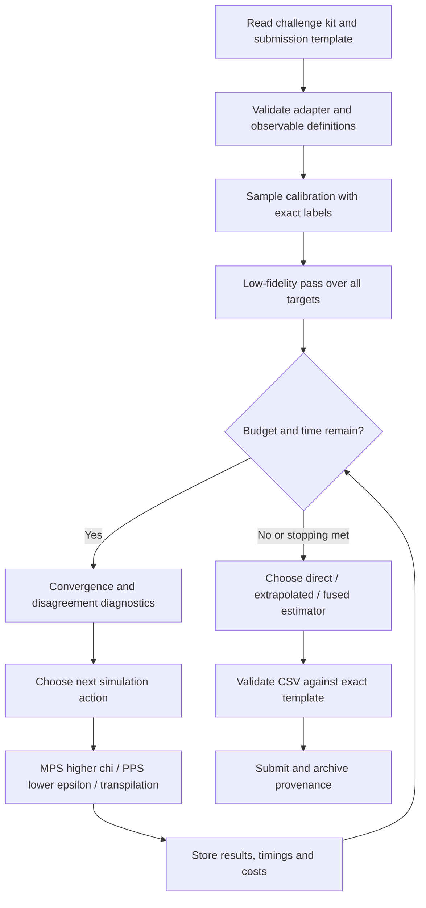

# BlueQubit OTOC Challenge: Multi-Fidelity Estimation and Adaptive Computation Algorithms

> **Technical Design Document · Version 1.0 (Pre-Competition Design)**  
> **Date: 2026-10-22**  
> **Event: DuQuantum 2026 / BlueQubit Quantum Simulation Challenge**  
> **Core task:** Estimate the OTOC(2) observables of hidden circuits using BlueQubit's available simulation backends, a limited computational budget, and public samples, without access to the gate sequences of the circuits used for official scoring.  
> **Status:** This document is an algorithm specification awaiting implementation, not a record of experiments that have been run or validated. The official challenge kit, actual scoring function, and hidden-circuit invocation interface will be released at kickoff on 2026-10-24. All items marked **[To be confirmed]** must be reviewed at that time.

---

## Executive Summary

**Core approach:** Use MPS sweeps over multiple bond dimensions and Pauli-path simulation (PPS) sweeps over multiple truncation thresholds as the two main branches. Decide whether to use extrapolation based on sample validation, and add vector-level convergence diagnostics, transpilation sensitivity analysis, cross-method consistency checks, adaptive computational budget allocation, and rigorously validated estimator fusion.

The overall closed-loop workflow is:

1. **Calibration:** Use the known exact answers for the two sample circuits to evaluate accuracy, score, and cost.
2. **Low-fidelity sweep:** Obtain inexpensive estimates for all accessible hidden observables, ensuring that a complete set of predictions is produced first.
3. **Multi-fidelity refinement:** Increase MPS $\chi$ and PPS accuracy (by decreasing $\epsilon$), respectively; attempt extrapolation when sample validation supports it.
4. **Uncertainty diagnostics:** Examine pointwise changes, changes in the shape of the full OTOC vector, disagreement between methods, and transpilation sensitivity.
5. **Adaptive scheduling:** Prioritize the next simulation with the greatest expected benefit per unit cost, updating results continuously.
6. **Estimator selection & submission:** Compare direct, extrapolated, and fused estimates; generate and validate a complete CSV; and reserve time for submission.

**Default policy:** *Prioritize the most trustworthy direct estimate. Extrapolation and fusion must demonstrate benefits on the samples. A smooth-looking convergence curve is not sufficient evidence that its limiting value is correct.*

**Minimum viable product (MVP):** Data ingestion and caching + MPS/PPS baselines + numerical and vector-level convergence checks + budget scheduling + a valid CSV. Transpilation ensembles, learned calibration, and complex extrapolation are optional enhancements.

---

## 1. Problem Definition & Objectives

### 1.1 Challenge description

According to the [official BlueQubit event page](https://app.bluequbit.io/hackathons/2GMaAenu3iSsIC6Z), the rules published as of 2026-10-22 are:

| Item | Officially published information |
|---|---|
| Task | Estimate observable expectation values corresponding to OTOC(2) |
| Official scoring data | **4 hidden circuits**, with multiple qubits per circuit, totaling approximately **140 values** |
| Public calibration data | **2 sample circuits**, with inspectable circuits and exact results |
| Hidden circuits | Gate sequences are not available for participants to inspect; BlueQubit executes the circuits via circuit IDs |
| Available simulation approaches | Exact / MPS / Pauli-path, with backends provided by BlueQubit |
| Submission format | CSV: `circuit,qubit,estimate`; the template is provided in the challenge kit |
| Scoring concept | Each circuit is scored separately; correlation / signal-to-noise between predicted and exact values; harder circuits later in the sequence receive higher weights |
| Schedule | 2026-10-24 11:30 AM ET to 2026-10-25 11:30 AM ET, a 24-hour period |
| Computational allowance | BlueQubit credits will be issued at the start of the competition; the amount has not yet been announced |

The official page also mentions that the challenge kit provides `challenge_tools.otoc2_circuit` (to construct the echo) and `challenge_tools.score_csv` (to score sample predictions). This **does not confirm** the complete Python signatures of these functions; interface adaptation must wait for the kit.

### 1.2 Mathematical notation

Let $c\in\mathcal C$ index circuits and $q\in\mathcal Q_c$ index the qubit/observable to be measured in a circuit. Define the exact target as:

$$
F^*_{c,q}=\operatorname{Tr}\!\left[\rho_0\,U_{c,q}^{\dagger}\,O_{c,q}\,U_{c,q}\right],
$$

Here, $U_{c,q}$ denotes, in general, the **OTOC(2) echo circuit** generated according to the challenge kit's definition, and $O_{c,q}$ is the corresponding measurement operator. **The official kit governs the exact circuit construction, normalization, sign, and qubit index conventions.** The formula above is a generic representation of an expectation-value task, not a claim that it is the kit's original definition.

Define the output vectors for a circuit as:

$$
\mathbf F_c^*=(F^*_{c,q})_{q\in\mathcal Q_c}\in\mathbb R^{n_c},\quad
\hat{\mathbf F}_c=(\hat F_{c,q})_{q\in\mathcal Q_c}.
$$

The actual scoring objective is written formally as:

$$
\max_{\hat{\mathbf F}_c}\ S_{\rm official}
=\sum_{c\in\mathcal C}w_c\,s_c(\hat{\mathbf F}_c,\mathbf F_c^*)
$$

Here, $w_c$ and $s_c$ are **currently unknown**. This is an abstract expression for algorithm design; it does not imply that the official score uses a specific weighted Pearson correlation formula.

Before the competition, use the following proxy metric:

$$
\rho_c(\mathbf x,\mathbf y)
=\frac{\langle\mathbf x-\bar x\mathbf 1,\mathbf y-\bar y\mathbf 1\rangle}
{\|\mathbf x-\bar x\mathbf 1\|_2\,\|\mathbf y-\bar y\mathbf 1\|_2},
$$

For official optimization, however, prioritize the kit's `score_csv`. If scoring includes amplitude error, noise normalization, or nonlinear terms, Pearson correlation cannot be treated as the final objective.

### 1.3 Optimization objectives & constraints

- **Primary:** Maximize the official score subject to both the credit budget and the deadline.
- **Secondary:** Reduce sample MAE/RMSE, improve cross-method consistency, and reduce failed jobs and duplicate computations.
- **Hard constraints:** Access hidden circuits only through competition-approved interfaces; do not rely on their invisible gate sequences; do not assume that BlueQubit's MPS/PPS kernels can be modified directly.
- **Operational constraints:** Measure API rates, per-job runtime limits, queue delays, device availability, and costs online rather than substituting static prices.

Formally, this is a constrained sequential experimental design problem:

$$
\max_{\pi}\ \mathbb E[S_{\rm official}(\hat{\mathbf F}^{\pi})]
\quad\text{s.t.}\quad C(\pi)\le B_{\rm credits},\quad T(\pi)\le T_{\rm deadline}.
$$

The policy $\pi$ determines which circuit, simulator, and precision setting to run next. Since the true gain is unknown, subsequent decisions use heuristics calibrated on samples and an online cost model.

### 1.4 Confirmed capabilities vs. conditional extensions

| Capability | Current status | Design treatment |
|---|---|---|
| MPS bond-dimension limit `mps_bond_dimension` | Confirmed in the SDK documentation | Main branch |
| PPS coefficient threshold `pauli_path_truncation_threshold` | Confirmed in the SDK documentation; minimum **`1e-5`** | Main branch; do not plan actual runs with smaller thresholds |
| PPS transpilation levels `0,1,2,3` | Confirmed in the SDK documentation; default is 2 | Enhancement; **[To be confirmed]** whether the challenge wrapper forwards this option |
| Exact sample-circuit labels and sample scoring | Described on the event page | Calibration |
| Exact syntax for invoking hidden circuits | **[To be confirmed]** | Isolate in the Adapter; do not guess the interface |
| Independent precision selection for each $q$ | **[To be confirmed]** | Support both per-observable and whole-circuit scheduling |
| Reuse of one simulation for multiple observables | **[To be confirmed]** | Record cost assessments at the actual job granularity |
| Availability of different PPS transpilation variants for hidden circuits | **[To be confirmed]** | Enable only after compatibility is verified |
| Exact scoring formula and per-circuit weights | **[To be confirmed]** | Replace proxy metrics after reading the kit |

**Device naming note:** The standard SDK API reference names the PPS device `pauli-path`, while another BlueQubit device list also includes `pauli-path.cpu` / `pauli-path.gpu`. Use the actual results obtained in the kickoff environment and challenge wrapper; do not assume these names are interchangeable.

---

## 2. Overall Algorithm Framework

### 2.1 High-level pipeline



**Core principle:** Ensure coverage of every required row before optimizing estimation accuracy; establish a baseline that can be submitted before trying complex models.

### 2.2 Functional modules

| Module | Input | Output | Responsibility |
|---|---|---|---|
| `ChallengeAdapter` | `(c, q, method, options)` | job/result | Encapsulate the kit / SDK without exposing implementation details |
| `ExperimentStore` | job metadata/result | normalized records | Cache, deduplicate, and track computation and costs |
| `SampleEvaluator` | samples + exact labels | score/error/cost report | Model selection and calibration |
| `MPSAnalyzer` | $F(\chi)$ series | direct + optional extrapolation | Evaluate MPS convergence |
| `PPSAnalyzer` | $F(\epsilon,\ell)$ series | direct + optional extrapolation | Evaluate PPS convergence and transpilation sensitivity |
| `UncertaintyEngine` | Results from each branch | diagnostics / proxy uncertainty | Identify jobs requiring refinement |
| `BudgetScheduler` | uncertainty, weights, costs | next actions | Schedule online under both budget constraints |
| `EstimatorSelector` | candidate predictions + sample evaluations | best prediction per circuit | Select/fuse outputs |
| `SubmissionValidator` | template + predictions | valid CSV | Check counts, order, IDs, and numerical values |

### 2.3 Data flow and invariants

1. Use `(circuit, qubit)` from the official template as the **sole authoritative index**; do not infer the required rows from qubit counts.
2. Record the method, parameters, transpilation level, job ID, SDK/kit versions, runtime, estimated/actual cost, and status for every estimate.
3. Every transformation (centering, scaling, fusion, or clipping) must create a new estimator version without overwriting raw simulator outputs.
4. Sample labels may be used only for sample calibration. Hidden labels are unavailable; do not use assumptions to "reconstruct" hidden ground truth.
5. Check the cache and running jobs before repeating a `(c,q,method,configuration)` request to avoid spending credits on duplicate work.

---

## 3. Sample-Based Calibration & Initial Benchmarking

### 3.1 Bootstrapping

At startup, proceed in this order:

1. Read `README.md`, the kit's `samples/`, `samples_exact.csv` (using the actual kit paths), the submission template, and the scoring tools.
2. Establish how OTOC(2) is constructed, how observables are normalized, how results are converted to real values, and what each `qubit` index means.
3. Complete an end-to-end smoke test on a minimal sample: *construct job → execute on BlueQubit → receive estimate → store result → construct CSV → run official scoring*.
4. Run an exact baseline for sample circuits that can be simulated exactly; compare against the sample ground truth to rule out observable/sign/index errors.
5. Only then begin small precision sweeps for MPS and PPS.

### 3.2 Initial parameter grids

These are **initial candidates** only, not official recommendations, and not every configuration needs to be run:

| Method | Initial candidates | Refinement strategy |
|---|---|---|
| MPS | $\chi\in\{32,64,128,256\}$ | Increase from low to high; stop on timeout or insert intermediate points |
| PPS | $\epsilon\in\{10^{-2},3\times10^{-3},10^{-3},3\times10^{-4},10^{-4}\}$ | Progress from coarse to fine; continue to $10^{-5}$ only if beneficial |
| PPS transpilation | Default to $\ell=2$; test $0/1/3$ | First compare stability and cost at the same $\epsilon$ |
| Exact | Affordable samples only | For validation; do not assume all hidden circuits can be simulated exactly |

Actual PPS thresholds below `1e-5` are outside the scope supported by the current documentation. For PPS circuits with more than 13 qubits, the current SDK documentation requires an explicit threshold.

### 3.3 Accuracy–cost benchmark

For sample circuit $s$ and estimator $m$, compute:

$$
\operatorname{MAE}_{s,m}=\frac1{n_s}\sum_q|\hat F^{(m)}_{s,q}-F^*_{s,q}|,
\qquad
\operatorname{RMSE}_{s,m}=\sqrt{\frac1{n_s}\sum_q(\hat F^{(m)}_{s,q}-F^*_{s,q})^2}.
$$

Also record:

- **Official sample score:** Use `challenge_tools.score_csv`; confirm input and return formats after the kit is released.
- **Pearson / Spearman correlation:** Support analysis of vector shape and rank consistency.
- **Runtime:** Wall time from submission to completion, backend compute time (if available), and queue time (if available).
- **Cost:** Actual credits consumed, tracked separately from wall time.
- **Failure rate:** Timeouts, OOM events, canceled jobs, and API errors.
- **Completeness:** Fraction of required rows covered by the current estimates.

### 3.4 Validation discipline

- Calibration has only **2 sample circuits**. Multiple qubits within one circuit **are not independent samples across circuits**.
- Use leave-one-circuit-out (LOCO) validation by default: select on sample A and validate on B, then reverse the roles. Report both individual results, not only their average.
- Do not repeatedly optimize dozens of free parameters on the samples; assign a negative prior to complex models with uncertain generalization.
- Retain a direct simulation baseline **without extrapolation or fusion** for all candidate strategies; compare every advanced strategy against this baseline.

### 3.5 Benchmark acceptance gate

Before entering the hidden-circuit stage, answer:

- Do trends in the official `score_csv` agree with Pearson correlation trends?
- Which of MPS/PPS performs better on the samples' cost–score Pareto frontier?
- In which regions does increasing $\chi$ / decreasing $\epsilon$ yield almost no further score improvement?
- Do these results hold for both sample circuits, or do they depend strongly on the instance?
- Which parameter combinations are runnable on the actual platform at manageable cost?

---

## 4. Multi-Fidelity OTOC Estimation

### 4.1 MPS-based estimation

For each target index that may be computed, define:

$$
F^M_{c,q}(\chi)=\text{MPS estimate with bond limit }\chi.
$$

Run simulations with increasing $\chi_1<\cdots<\chi_K$. Diagnose changes between adjacent points:

$$
\Delta^M_{c,q,k}=|F^M_{c,q}(\chi_k)-F^M_{c,q}(\chi_{k-1})|.
$$

**Candidate extrapolation model:**

$$
F^M_{c,q}(\chi)\approx F^M_{c,q,\infty}+a_{c,q}\chi^{-p},\qquad p>0.
$$

This is an empirical fit only. MPS expectation values at finite bond dimension **are not guaranteed** to follow a fixed power law, nor is their error guaranteed to be monotonic. Implement two types of estimator:

1. **Direct:** The raw output at the highest trustworthy $\chi$ (must be retained).
2. **Extrapolated:** Enable only when enough precision points are available, the fit is stable, and extrapolation is effective on the samples.

Suggested extrapolation validation: fit the coarser points and predict a held-out finer point; compare against simply using the last coarse point directly. If the next precision point cannot be predicted reliably, do not use the more distant $\chi\to\infty$ extrapolation.

**Reject extrapolation if any of the following applies:**

- Too few points are available to distinguish a plateau from a fitted trend;
- The fitted $p$ or $F_\infty$ is highly sensitive to removing a data point;
- The curve is clearly nonmonotonic and different fitting windows yield conflicting limits;
- The inferred extrapolation step is much larger than the numerical changes observed;
- The official sample score is below that of the best direct estimate.

**Fallback:** Use the best validated $\chi$ directly and record `extrapolation_rejected` in the metadata.

### 4.2 Pauli-path-based estimation

Define:

$$
F^P_{c,q}(\epsilon,\ell)=\text{PPS estimate with truncation threshold }\epsilon
\text{ and transpilation level }\ell.
$$

At fixed $\ell$, progressively reduce the threshold from a large value within the platform-supported range:

$$
\epsilon_1>\epsilon_2>\cdots\ge 10^{-5}.
$$

Candidate extrapolation form:

$$
F^P_{c,q}(\epsilon,\ell)
\approx F^P_{c,q,0}(\ell)+b_{c,q,\ell}\epsilon^r,\qquad r>0.
$$

**Special caution:** The current implementation discards terms according to an absolute-value threshold on Pauli coefficients during propagation. As $\epsilon$ crosses coefficient thresholds, results may be stepwise, nonsmooth, or nonmonotonic. The mathematical limit $\epsilon\to0$ must not be treated as a reliable extrapolation from finitely sampled points.

Use **piecewise diagnostics**:

- Differences between adjacent estimates and relative changes;
- Checks for plateaus across several consecutive thresholds;
- Separate fits over different threshold subranges, with comparisons of result stability;
- Caution about plateaus within the feasible threshold range: **unchanged does not mean unbiased**; additional Pauli terms may simply not have been activated yet.

By default, use the direct result at the smallest **affordable** threshold; enable extrapolation only after sample validation succeeds.

### 4.3 Transpilation sensitivity / ensemble

When the interface permits it, test $\ell\in\{0,1,2,3\}$. Different transpilation representations may change PPS truncation behavior, runtime cost, and numerical bias.

For outputs at multiple levels with the same $\epsilon$, define:

$$
\bar F^P_{c,q}(\epsilon)=\frac1L\sum_{\ell\in\mathcal L}F^P_{c,q}(\epsilon,\ell),
$$

$$
\sigma^P_{\mathrm{trans},c,q}(\epsilon)
=\sqrt{\frac{1}{L-1}\sum_{\ell\in\mathcal L}
\left[F^P_{c,q}(\epsilon,\ell)-\bar F^P_{c,q}(\epsilon)\right]^2}.
$$

Here, $L\ge2$. **$\sigma_{\rm trans}$ measures representation sensitivity only; it is neither a standard deviation from independent random experiments nor an error bar with guaranteed coverage.** Averaging across levels is also not guaranteed to outperform the best level.

Recommendations:

1. Start with level 2, the default in the SDK documentation;
2. Compare actual score/cost for another 1–2 levels on the samples;
3. Add levels only for hidden targets where differences exist and may be useful;
4. Treat increasing agreement between levels as $\epsilon$ decreases as supplementary convergence evidence; if disagreement grows, reduce trust in that estimator.

### 4.4 Estimator selection within each branch

Retain candidate sets for each branch:

$$
\mathcal E_M=\{\text{highest-fidelity direct},\text{validated extrapolation}\},
$$

$$
\mathcal E_P=\{\text{highest-fidelity direct},\text{validated extrapolation},\text{validated level ensemble}\}.
$$

Selection should prioritize the samples' **official scores and robustness of generalization**, followed by fitting residuals or apparent parameter convergence. Avoid freely choosing among many estimators independently for each hidden qubit, which would introduce uncontrolled selection bias; prefer a small set of shared rules applied at the circuit level.

---

## 5. Convergence & Uncertainty Quantification

### 5.1 Pointwise convergence indicators

For estimates at two consecutive precision levels, define the absolute change:

$$
D^{\mathrm{point}}_{c,q,m,k}=\big|F^{(m)}_{c,q,k}-F^{(m)}_{c,q,k-1}\big|.
$$

To avoid division by an unstable quantity near zero, do not use the relative error $D/|F|$ alone. Define a robust scale:

$$
s_c=\max\left(\operatorname{MAD}(\hat{\mathbf F}_c),\ s_{\min}\right),
$$

Use $D/s_c$ as a **dimensionless heuristic feature**. Set $s_{\min}$ according to the scale of the samples; do not arbitrarily make it too small.

### 5.2 Vector-shape convergence

For the same circuit, center and normalize the vector:

$$
\mathbf z(\mathbf x)=\frac{\mathbf x-\bar x\mathbf 1}{\|\mathbf x-\bar x\mathbf 1\|_2},
$$

This requires the centered norm to be sufficiently large. Between vectors at adjacent precision levels:

$$
D^{\mathrm{shape}}_{c,m,k}
=1-\rho\!\left(\mathbf F^{(m)}_{c,k},\mathbf F^{(m)}_{c,k-1}\right).
$$

Also compute rank consistency, such as Spearman $\rho_S$, to determine whether the ordering is still changing.

**Important limitation:** If a vector is nearly constant, Pearson correlation / the normalized direction is extremely sensitive to small perturbations. In this case, stop relying on `D_shape` and use absolute RMS differences and the range of the raw estimates instead. Do not regard two nearly constant vectors as "high confidence."

For scoring dominated by correlation, distinguish the following cases:

- A substantial overall shift in values with almost unchanged centered shape: this may already suffice for a correlation-dominated score;
- Small changes in individual elements while rank/shape continues to change: further refinement is more meaningful;
- Stable shapes while both methods are wrong: trust may still be overstated, requiring sample calibration.

### 5.3 Cross-method consistency

Compare MPS and PPS outputs using:

$$
D^{\mathrm{cross}}_c=1-\rho(\hat{\mathbf F}^M_c,\hat{\mathbf F}^P_c),
$$

and the raw pointwise disagreement:

$$
d^{\mathrm{cross}}_{c,q}=|\hat F^M_{c,q}-\hat F^P_{c,q}|.
$$

These measure different aspects: the former primarily concerns shape, while the latter includes offset/scale differences. If the algorithms produce outputs on different scales, also record the pointwise differences after centering and normalization, $|z_{M,q}-z_{P,q}|$.

**This does not imply that the true value lies between the two estimates.** MPS and PPS may have systematic biases in the same direction, especially in the scrambling regime of deep circuits.

### 5.4 Heuristic uncertainty indicator

Construct a feature vector:

$$
\boldsymbol\phi_{c,q}=(d^M_{\rm step},d^P_{\rm step},d_{\rm cross},d_{\rm trans},d_{\rm shape,c},r_{\rm cost},\ldots).
$$

First account for the units and scales of all quantities. Define:

$$
U_{c,q}=g_{\rm conservative}(\boldsymbol\phi_{c,q})\ge0.
$$

For the initial version, use a nonnegative linear combination with fixed weights or the maximum across features, with limited calibration against exact sample errors. Training a neural uncertainty model is unnecessary.

**Interpretation limit:** $U$ is an *uncertainty proxy* for ranking, not a statistical probability such as $\Pr(|\hat F-F^*|<\delta)$. Terms such as "confidence interval" or "standard error" require an appropriate statistical model or validation of frequentist coverage.

### 5.5 Quality states and stopping signals

Each circuit may maintain one of four **internal engineering labels**, `LOW / MEDIUM / HIGH / UNSTABLE`. For example:

- `LOW`: Only a single low-fidelity estimate is available;
- `MEDIUM`: Changes between adjacent precision levels are shrinking for at least one method, and the output is valid;
- `HIGH`: Shapes are stable across precision levels within a parameter region that performs well on the samples, with support from an independent method or transpilation level;
- `UNSTABLE`: Increased precision causes unusually large changes, job failures, anomalous scales, or strong conflicts between methods.

These are **operational labels**, not scientific conclusions that guarantee accuracy.

---

## 6. Adaptive Computational Resource Allocation

### 6.1 Action space

Denote an executable action by:

$$
a=(c,I,m,\lambda_m),
$$

Here, $c$ is the circuit, $I\subseteq\mathcal Q_c$ is the affected set of observables, $m\in\{\mathrm{MPS},\mathrm{PPS}\}$, and $\lambda_m$ is $\chi$ or $(\epsilon,\ell)$.

**Both operating modes must be included in the design:**

- **Mode A — per-observable:** *Only if the challenge interface allows an individual $q$ to be run and billed independently*, set $I=\{q\}$ and use pointwise scheduling.
- **Mode B — whole-circuit / bundled batch:** If a run always computes multiple observables or shares an expensive circuit simulation, $I$ is the full set actually covered by the platform. Aggregate scheduling, costs, and gains by batch; do not make unsupported claims of savings for individual qubits.

After kickoff, measure the actual billing granularity of a job, observable batching capabilities, and shared reuse capabilities before enabling the most suitable mode.

### 6.2 Initial low-fidelity pass

Obtain at least one valid prediction for every required submission row:

1. Use sample results to select inexpensive configurations for each method;
2. Run an inexpensive, reliable baseline for all hidden targets;
3. If a backend fails, automatically switch to the other backend or retain a previously successful result;
4. Save the complete baseline as a checkpoint that cannot be overwritten, and perform the first submission-format validation as early as possible.

**Coverage takes priority over refinement.** If any rows remain uncovered near the deadline, prioritize filling them with valid results and suspend ensemble / extrapolation experiments.

### 6.3 Cost model

Maintain predictions for every candidate action:

$$
\hat C(a)=\text{estimated credits},\qquad
\hat T(a)=\text{estimated elapsed wall time}.
$$

Fit a rough model from the measured costs of the first small jobs. Use a robust median or a conservative upper quantile so that one unusually fast run does not cause the budget to be underestimated.

**Note:** The standard BlueQubit `BQClient.estimate()` documentation lists mainly statevector CPU/GPU devices; it does not promise accurate cost predictions directly for MPS/PPS or hidden challenge jobs. Do not rely on this function to cover every case. Actual billing / credit deductions take precedence.

Maintain:

$$
C_{\rm used}+\hat C(a)+C_{\rm reserve}\le B_{\rm total},
$$

and

$$
T_{\rm remaining}\ge\hat T(a)+T_{\rm submission\ buffer}.
$$

Check the two constraints independently; ample credits do not imply sufficient wall time.

### 6.4 Priority score

The ideal selection criterion, which cannot be computed directly, is:

$$
a^*=\arg\max_a\frac{\mathbb E[\Delta S_{\rm official}\mid a]}{\hat C(a)+\lambda_T\hat T(a)}.
$$

For a practical initial version, use:

$$
P(a)=\frac{\hat w_c\cdot \hat I(a)\cdot \hat R(a)}
{\hat C(a)+\lambda_T\hat T(a)+\delta},
$$

where:

- $\hat w_c$: Use the official circuit weight if known; otherwise, use only a coarse ordinal priority and do not invent numerical weights.
- $\hat I(a)$: The aggregate uncertainty / shape influence of the affected observables.
- $\hat R(a)$: A factor assessing whether the next precision level is likely to improve results, based on recent gains from increased precision; use a conservative constant when evidence is absent.
- $\lambda_T$: A manually set coefficient that converts limited time into a penalty; $\delta>0$ prevents division by zero.

If an action computes a whole circuit, aggregate $\hat I(a)$ over the entire set $I$ rather than taking the maximum for a single qubit.

### 6.5 Greedy adaptive refinement

Use a greedy scheduler with low computational overhead and interpretable behavior:

1. Collect all *currently feasible* actions (the next $\chi$, the next $\epsilon$, and a new $\ell$ when necessary).
2. Compute predicted cost, time, gain proxy, and failure risk for each action.
3. Filter out over-budget actions, actions that clearly cannot finish in time, and duplicate jobs.
4. Choose the highest-priority action, or several nonconflicting actions to run concurrently (within the measured concurrency capacity of the interface).
5. After completion, update results, actual costs, and each $U_{c,q}$.
6. If a branch yields almost no gain over several consecutive refinements, temporarily reduce its priority; allow later evidence to reverse this decision.
7. Periodically reassess the global allocation to avoid exhausting the budget on the circuits started first.

### 6.6 Stopping criteria

Any of the following may trigger stopping for a circuit/method:

- The predicted benefit per cost of further precision increases is below that of other executable actions;
- Vector shapes are stable across several adjacent precision levels, and samples indicate little benefit from additional precision;
- Repeated timeouts/OOM events occur, or the next level is unlikely to finish before the deadline;
- The cost of an action exceeds the remaining nonreserved budget;
- Bias remains large but no longer improves with precision: mark as `UNSTABLE` and consider switching methods.

Global stopping is governed by **complete, valid predictions + budget exhaustion / the submission time buffer being reached**. Do not miss submission in pursuit of higher precision.

---

## 7. Multi-Fidelity Ensemble & Error Calibration

### 7.1 Direct estimator as the anchor

First establish a single-method anchor for each circuit, such as the highest trustworthy precision MPS or PPS vector from the method that performs better on the samples:

$$
\hat{\mathbf F}_{c,\mathrm{anchor}}.
$$

Every fusion scheme must report **gains relative to the anchor**. If fusion does not consistently improve the score in sample LOCO validation, revert to the anchor.

### 7.2 Raw-value fusion

The simplest scheme is:

$$
\hat{\mathbf F}_{c,\mathrm{mix}}
=w\hat{\mathbf F}^{M}_c+(1-w)\hat{\mathbf F}^{P}_c,\quad w\in[0,1].
$$

For example, test only $w\in\{0,0.25,0.5,0.75,1\}$ to avoid fitting many parameters with only two sample circuits.

Perform two-way LOCO on the two samples, evaluating the mean score, worst circuit score, and difference from the baseline. **Do not treat a higher training score as a guarantee of generalization.**

### 7.3 Shape-aware fusion

If official scoring and sample tests show particular sensitivity to centered shape, consider:

$$
\mathbf z_M=\mathbf z(\hat{\mathbf F}_M),\quad
\mathbf z_P=\mathbf z(\hat{\mathbf F}_P),
$$

$$
\mathbf z_{\rm mix}=w\mathbf z_M+(1-w)\mathbf z_P.
$$

The final CSV must still contain actual scalar estimates. If scoring includes amplitude information, restore scale and offset, for example using the anchor:

$$
\hat{\mathbf F}_{\rm mix,restored}
=\bar F_{\rm anchor}\mathbf 1
+\|\hat{\mathbf F}_{\rm anchor}-\bar F_{\rm anchor}\mathbf 1\|_2
\frac{\mathbf z_{\rm mix}}{\|\mathbf z_{\rm mix}\|_2}.
$$

This requires $\|\mathbf z_{\rm mix}\|_2>0$. The restoration procedure is a design candidate only, **not a universally optimal choice of scale**. If official scoring is not affine-invariant, validate with `score_csv` and disable this branch entirely if necessary.

### 7.4 Sample-based bias correction (optional)

Construct residuals using exact sample labels:

$$
r_{s,q}=F^*_{s,q}-\hat F_{s,q}.
$$

A low-complexity model is:

$$
\hat r_{s,q}=\boldsymbol\beta^\top\boldsymbol\phi_{s,q},
\qquad
\hat F_{c,q}^{\rm corrected}=\hat F_{c,q}+\hat r_{c,q}.
$$

Limit trials to constant corrections, simple linear corrections, and strongly regularized Ridge regression; do not rely on large neural networks. Training features must be computable for hidden circuits; unobservable quantities such as exact hidden-circuit errors cannot be used.

**Acceptance gate:** Neither direction of LOCO shows material degradation, and corrected outputs satisfy physical and numerical range requirements. With only two sample circuits, this remains a high-risk enhancement even after validation and should not take computational priority over the baseline.

### 7.5 Physics-aware postprocessing (strictly conditional)

OTOC symmetries, lattice-position dependence, or local smoothing may be explored only if the kit explicitly supplies the physical geometry, symmetries, and exact observable definitions. **Do not** impose smoothing by qubit index, sign flips, or range restrictions without justification.

If the measurement is confirmed to be a normalized Hermitian observable, check its physical range according to the definition. If the OTOC definition is complex-valued but the official task projects it onto a real scalar, follow the kit strictly. Do not assume that all results can be clipped to $[-1,1]$.

### 7.6 Final estimator selection

| Candidate | Default stance | Enable when |
|---|---|---|
| Highest-fidelity MPS direct | baseline candidate | Runnable with valid output |
| Highest-fidelity PPS direct | baseline candidate | Runnable with valid output |
| MPS extrapolation | optional | Stable fit + held-out precision validation + sample score improvement |
| PPS extrapolation | optional | Same as above, with nonsmoothness checks passed |
| Transpilation ensemble | optional | Multiple levels provide consistent gains on samples |
| MPS/PPS ensemble | optional | LOCO validation outperforms a single method |
| Bias-corrected estimator | high-risk optional | Strict validation and no physical anomalies |

Make final selections at the **circuit level** wherever possible to avoid inconsistent output scales from selecting different methods for individual qubits. Consider pointwise strategies separately only if official scoring strongly supports them.

---

## 8. Validation & Ablation Studies

### 8.1 Required experiments

| Experiment | Purpose | Minimum output |
|---|---|---|
| Exact vs. MPS/PPS on samples | Confirm correctness of the basic estimates | error–cost curves |
| MPS $\chi$ sweep | Study convergence and suitability for extrapolation | precision curves + held-out prediction |
| PPS $\epsilon$ sweep | Check threshold sensitivity | precision curves + plateau flags |
| PPS transpilation comparison | Analyze representation dependence | inter-level disagreement + cost |
| Vector-shape analysis | Align with correlation-based scoring | Pearson/Spearman vs. fidelity |
| Ensemble grid | Determine whether fusion improves results | two-way LOCO score table |
| Adaptive vs. uniform budget | Validate scheduling gains | best score vs. credits/time |

### 8.2 Ablation matrix

Define versions with progressively increasing complexity:

- **A0:** MPS direct only.
- **A1:** PPS direct only.
- **A2:** A0/A1 + validated extrapolation within each branch.
- **A3:** A2 + vector-aware convergence / early stopping.
- **A4:** A3 + adaptive budget scheduler.
- **A5:** A4 + validated MPS/PPS fusion.
- **A6:** A5 + conditional transpilation ensemble / bias correction.

For each ablation, report the sample score, lowest individual circuit score, completion rate, and added complexity under equal credits or equal wall time. Retain the simpler version if the advanced version does not improve results substantially.

### 8.3 Robustness checks

1. Change the fitting window and remove one precision point from the extrapolation model to see whether the inferred limit changes substantially.
2. Test fusion-weight sensitivity on a coarse grid to avoid relying on a single precisely tuned setting.
3. Validate separately on both sample circuits rather than merging them into one large training set and reporting a single correlation.
4. Use separate failure diagnostics for nearly constant vectors, pronounced outliers, and strong conflicts between branches.
5. If backend results are not strictly deterministic, repeat the same job configuration to assess numerical reproducibility; stop unhelpful repetitions if determinism is adequate.
6. Run input-completeness and result-consistency smoke tests for `score_csv` to ensure that apparent score gains are not caused by misaligned rows.

### 8.4 Scientific cautions

- Smaller thresholds / larger bond dimensions do not guarantee monotonic costs or errors; use actual run results.
- Agreement between two numerical backends is useful evidence, but not proof of unbiasedness.
- Small changes between adjacent precision levels indicate only **local stability**; shared bias or false plateaus may remain.
- Optimizing Pearson alone may harm the actual signal-to-noise score; the official scoring implementation is always the final authority.

---

## 9. Implementation & Execution Workflow

### 9.1 Repository structure

```text
bluequbit-otoc/
├── README.md
├── config/
│   ├── settings.yaml          # budget, grids, stopping and fallback
│   └── challenge_adapter.yaml # device names and supported options; fill at kickoff
├── src/
│   ├── adapter.py              # challenge-kit-specific calls ONLY
│   ├── store.py                # job metadata, cache and immutable raw records
│   ├── sweep.py                # MPS/PPS fidelity progression
│   ├── diagnostics.py          # convergence and cross-method checks
│   ├── extrapolation.py        # candidate fitting and rejection gates
│   ├── scheduler.py            # action generation and priority ranking
│   ├── ensemble.py             # validated estimator selection and fusion
│   ├── scoring.py              # exact sample metrics + official scorer adapter
│   └── submission.py           # template-locked CSV generation
├── data/
│   ├── samples/                # distributed kit files (do not mutate)
│   ├── jobs.jsonl              # append-only audit log
│   ├── estimates.parquet       # normalized simulation estimates
│   └── checkpoints/           # valid snapshots of current predictions
├── reports/
│   ├── sample_benchmarks.md
│   ├── convergence_diagnostics.csv
│   ├── adaptive_budget_log.csv
│   └── candidate_scores.csv
└── submissions/
    ├── baseline.csv
    └── final.csv
```

### 9.2 Job/result schema

Each job record should contain at least:

```yaml
job_key: "<stable hash of circuit + observable set + method + options>"
circuit: "<official circuit ID>"
qubits: ["<official qubit labels>"]
method: "mps | pps | exact"
device: "<actual device string>"
options:
  mps_bond_dimension: null
  pauli_path_truncation_threshold: null
  pauli_path_circuit_transpilation_level: null
status: "planned | running | succeeded | failed | canceled"
job_id: null
started_at: null
finished_at: null
wall_seconds: null
credits_consumed: null
estimates: {}          # official qubit label -> numeric estimate
sdk_version: null
kit_version: null
error: null
```

In practice, store each job once and expand its observables into the estimates table, avoiding the mistaken assumption that 1 job = 1 qubit.

### 9.3 Suggested initial configuration

These are engineering **starting candidates**, not fixed competition requirements:

```yaml
mode: pre_release_design

methods:
  mps:
    enabled: true
    bond_dimensions: [32, 64, 128, 256]
    extrapolation: optional_after_validation
  pps:
    enabled: true
    thresholds: [0.01, 0.003, 0.001, 0.0003, 0.0001, 0.00003, 0.00001]
    default_transpilation_level: 2
    extra_transpilation_levels: [0, 1, 3]
    extrapolation: optional_after_validation

selection:
  baseline_first: true
  calibration_scheme: leave_one_sample_circuit_out
  ensemble_weights: [0.0, 0.25, 0.5, 0.75, 1.0]
  prefer_direct_if_uncertain: true

scheduler:
  granularity: auto_detect # per-observable | whole-circuit | batch
  provisional_credit_reserve_fraction: 0.15
  stop_on_unknown_cost: true
  prioritize_complete_submission: true

submission:
  use_official_template: true
  validate_exact_row_keys: true
  require_finite_estimates: true
```

`0.15` is only an initial safety-buffer recommendation. After kickoff, revise it dynamically based on total credits, queue delays, and job costs. The configuration does not preset concurrency; first confirm the concurrency permitted by the platform.

### 9.4 Main algorithm pseudocode

The following is **algorithm pseudocode**, not the actual runnable BlueQubit challenge-kit API. Function names represent this project's internal abstract interfaces.

```python
# PSEUDOCODE -- NOT THE RELEASED BLUEQUBIT CHALLENGE API

kit = ChallengeAdapter.load_release_kit()
targets = kit.read_submission_template()  # exact authoritative (circuit, qubit) keys
samples = kit.read_sample_labels()
store = ExperimentStore()

assert kit.validate_observable_definition()
assert kit.smoke_test_sample()

# Stage 1: calibration
calibration = run_sample_benchmark(
    kit=kit,
    samples=samples,
    parameter_grids=config.initial_grids,
    official_scorer=kit.score_csv,
    store=store,
)
policy = select_conservative_policy(calibration, group_by="circuit")

# Stage 2: obtain a valid estimate for every required row
for action in policy.make_coverage_jobs(targets, kit.available_capabilities):
    if not store.has_successful_equivalent(action):
        result = kit.run_simulation(action)
        store.record(result)

current = select_best_available_estimates(targets, store, policy)
assert covers_all_required_rows(current, targets)
save_valid_baseline_checkpoint(current, targets)

# Stage 3: iterative precision refinement
while not deadline_buffer_reached() and not budget_reserve_reached():
    diagnostics = analyze_convergence_and_disagreement(store, targets)
    candidates = generate_supported_next_actions(
        store=store,
        capabilities=kit.available_capabilities,
        granularity=kit.detect_granularity(),
    )
    feasible = filter_by_cost_time_failure_and_cache(candidates)
    if not feasible:
        break

    action = choose_action_using_proxy_gain_per_cost(
        feasible, diagnostics, calibration, store.observed_costs
    )
    result = kit.run_simulation(action)
    store.record(result)  # also updates actual runtime/credits

    current = select_best_available_estimates(targets, store, policy)
    if covers_all_required_rows(current, targets):
        save_valid_checkpoint(current, targets)

# Stage 4: estimator selection and finalization
candidate_estimators = build_validated_candidates(store, calibration)
final_estimates = choose_conservative_circuit_level_estimators(
    candidate_estimators,
    fallback=load_last_valid_checkpoint(),
)
final_csv = write_csv_exactly_like_template(final_estimates, targets)
assert validate_submission_csv(final_csv, targets)
archive_job_metadata_and_config()
# Submit final_csv through official submission procedure before deadline.
```

### 9.5 Safe production controls

- **API adapter isolation:** Centralize all code involving circuit IDs, echo construction, devices, and `options` in `adapter.py`.
- **Secrets:** Read tokens from environment variables; never write them to the repository, logs, notebook outputs, or submission files.
- **Caching:** Include the method, all backend parameters, circuit ID, observable indices, and kit version in the configuration hash.
- **Idempotency:** After a network timeout, check whether the job has already been created/completed before deciding to retry, avoiding duplicate charges.
- **Timeout recovery:** Preserve error codes, the last successful results, and fallback paths for failed jobs; do not retry indefinitely.
- **Atomic checkpoints:** Write a temporary file completely, validate it, then replace the destination file to avoid corrupting the only valid output midway through a write.
- **Parallelism:** Measure API concurrency / billing first; avoid mistaking shared-resource contention for numerical algorithm runtime.
- **Final checkpoint:** Retain `baseline.csv` permanently to ensure that advanced optimization has not compromised the basic result that can be submitted.

### 9.6 CSV generation & validation

The output format is strictly:

```csv
circuit,qubit,estimate
<official-circuit-id>,<official-qubit-id>,<finite-float>
```

This is only an **illustration of the field conventions**. Read actual `circuit` and `qubit` values, row counts, and ordering from the official template; do not submit angle-bracket placeholders.

Before submission:

1. Match the header exactly to official requirements.
2. Ensure that the `(circuit, qubit)` set **matches the template exactly**, with no missing, duplicate, or extra rows.
3. Ensure that all estimates parse as finite real numbers, with no `NaN`, `inf`, empty values, or string placeholders.
4. Ensure that numerical scales, signs, and types comply with the kit's OTOC definition.
5. Pass the official scoring/submission precheck tools, if available, and save the submission file hash.
6. Do not run destructive scripts that could jeopardize delivery immediately before the final submission.

---

## 10. Competition Execution Strategy

### 10.1 Pre-competition preparation

- Prepare a clean Python environment, the `bluequbit` SDK, required scientific computing dependencies, and environment-variable injection.
- Implement data structures, a CSV validator, plots/tables, caching, a generic scheduler, and a **placeholder** challenge adapter.
- Prepare MPS/PPS parameter-grid scripts that can run on the sample circuits.
- Prepare job-cost visualizations and a recovery strategy for the last valid submission version.
- **Do not invent in advance** hidden circuit IDs, kit import paths, scoring-function signatures, or credit amounts.

### 10.2 At kickoff: release-kit compatibility checklist

- [ ] Download and read the official `README.md`, challenge kit, and submission template.
- [ ] Confirm how hidden circuit IDs are invoked and whether execution remains restricted to the platform.
- [ ] Confirm the actual inputs, outputs, and versions of `otoc2_circuit` / `score_csv`.
- [ ] Confirm target-vector sizes, qubit indices, and observable definitions.
- [ ] Confirm the actual scoring weights / score function for the four circuits.
- [ ] Test whether the challenge wrapper accepts the actual MPS/PPS device names and parameters.
- [ ] Confirm API billing/reuse granularity for single qubits, whole circuits, and batches.
- [ ] Confirm the credit allowance, queues, per-job limits, concurrency limits, and billing policy for failures.
- [ ] Check exact answers and the official scoring function on the samples.
- [ ] Generate a complete, valid baseline CSV as soon as possible.

### 10.3 Proposed 24-hour phases

| Competition phase (relative to kickoff) | Focus | Gate / deliverable |
|---|---|---|
| 0–1 h | Adapt to the kit, confirm scoring/credits, and run an end-to-end smoke test | Correctly construct and execute sample jobs |
| 1–4 h | Sample baselines and minimal parameter sweeps | Preliminary method/cost/score conclusions |
| 4–8 h | Prioritize hidden-target coverage + initial multi-fidelity runs | **A complete, recoverable baseline CSV** |
| 8–18 h | Closed-loop adaptive refinement, focusing on high-weight/unstable circuits | The most effective multi-fidelity estimates |
| 18–21 h | Conservatively screen extrapolation/ensemble candidates; continue high-return refinement | An interpretable final estimator policy |
| 21–23 h | Stability checks, submission-file verification, and backups | Final compliant CSV |
| 23–24 h | Buffer for the actual submission process; handle emergencies only | Successful, confirmed submission |

This is a draft execution schedule, not a rigid minute-by-minute plan. **Do not delay the first valid submission while waiting for a long-running job.** If multiple submissions are allowed, confirm the replacement/update rules early.

### 10.4 Priority / fallback policy

When time is short, retain functionality in this order:

1. Correct API adaptation and a complete CSV.
2. A baseline from one reliable simulation backend that can be submitted.
3. Inexpensive cross-checks using both backends.
4. Vector-level convergence assessment + cost-driven incremental refinement.
5. Validated extrapolation or a simple ensemble.
6. Transpilation extensions, bias correction, and other exploration.

If a high-weight circuit is very expensive, do not automatically commit the entire budget to it. Compare its current potential for improvement with gains available on other circuits to avoid spending large amounts of credits on a numerical plateau without measurable progress.

---

## 11. Acceptance Criteria & Research Decisions

### 11.1 MVP is complete when

- A sample-circuit smoke test verifies that OTOC(2) calls agree with official labels.
- At least one of MPS/PPS is runnable, and finite values can be generated for every required row.
- Precision parameters, job IDs, costs, statuses, results, and recoverable checkpoints are saved.
- At least pointwise and vector-level convergence indicators are included.
- Scheduling to the next precision level operates under both time and cost limits and can stop safely.
- The generated CSV matches the official template exactly.

### 11.2 Advanced components are accepted only when

- Extrapolation outperforms the highest-fidelity direct estimate, and the gain is not merely a chance effect on one sample.
- Fusion shows no material degradation in two-way LOCO tests.
- Adaptive scheduling outperforms a fixed grid at equal cost or equal wall time.
- Additional transpilation levels provide enough score/robustness gains to justify their credit consumption.
- No complex calibration model can bypass the fallback policy.

### 11.3 Main scientific questions

1. For OTOC(2), in which regimes of numerical difficulty are MPS and PPS each more effective?
2. Do changes in $\chi$ and $\epsilon$ exhibit empirical scaling stable enough to support extrapolation?
3. Can shape convergence of the prediction vector detect score saturation earlier than pointwise absolute error?
4. Can transpilation sensitivity serve as a PPS truncation-error proxy?
5. Does disagreement between methods effectively predict actual sample error, or does it mainly reflect output-scale differences?
6. Under limited credits and a 24-hour deadline, is adaptive refinement more valuable than uniformly increasing precision?
7. With only two sample circuits, which fusion strategy generalizes most reliably?

---

## Appendix A. Numerical Diagnostics Cheat Sheet

| Symbol | Meaning | Interpretation caveat |
|---|---|---|
| $D^{\rm point}$ | Pointwise difference between adjacent precision levels | Small values do not imply unbiasedness |
| $D^{\rm shape}$ | Change in full-vector correlation between adjacent precision levels | Unstable for nearly constant vectors |
| $D^{\rm cross}$ | Shape mismatch between MPS/PPS | Agreement does not imply closeness to exact results |
| $\sigma_{\rm trans}$ | Sensitivity to PPS transpilation representation | Not a true statistical variance |
| $U_{c,q}$ | Internal heuristic uncertainty ranking | Not a calibrated confidence interval |
| $\hat C(a)$ | Predicted credits for an action | Must be corrected using actual costs |
| $\hat T(a)$ | Predicted wall time for an action | Not simply compute time |
| $\Delta S$ | Expected score improvement from an additional simulation | Only a proxy can be estimated without hidden labels |

### A.1 Extrapolation rejection protocol

A simple, conservative protocol:

1. Retain at least 4 reasonably separated numerical precision levels;
2. Fit the first three levels and predict the fourth;
3. Compare the extrapolation prediction's error at the fourth level against the error of using the third-level direct estimate for the fourth;
4. Slide the fitting window and check the robustness of the inferred limit;
5. Compare actual scores against exact sample labels;
6. Disable extrapolation if any step fails.

Note: Using the fourth level as a validation target tests only whether the local trend is predictable; it does not prove correct convergence as $\chi\to\infty$ or $\epsilon\to0$.

### A.2 When the observable vector is nearly constant

If $\|\mathbf F-\bar F\mathbf 1\|_2$ falls below a preset numerical tolerance:

- Flag `NEAR_CONSTANT_VECTOR` and do not report or use Pearson-based stability;
- Use uncentered RMS and pointwise differences to assess numerical evolution;
- Once the official score formula is released, handle scoring of nearly constant vectors according to its definition.

### A.3 Decision rule under model disagreement

When MPS/PPS disagree substantially while each appears internally converged:

1. Check that observable definitions, qubit ordering, units/signs, and normalization match exactly;
2. Increase precision for the method expected to provide improvement at lower cost;
3. If PPS is sensitive to transpilation, first compare trends across levels;
4. Do not blindly take the midpoint of the two results;
5. If systematic bias still cannot be ruled out, choose the anchor that is more robust on samples and record a low-trust label.

---

## Appendix B. Risk Register

| Risk | Symptom | Mitigation |
|---|---|---|
| A setting is unavailable through the hidden-circuit API | Parameter rejected / silently ignored | Have the adapter first test on samples whether the parameter takes effect |
| Actual job granularity is the whole circuit | Per-point jobs do not reduce costs | Switch to batch/whole-circuit scheduling |
| PPS threshold reaches the backend minimum | $\epsilon$ cannot be reduced further | Stop the branch and shift budget to MPS/other levels |
| Unstable extrapolation | Inferred limits jump sharply with the fitting window | Reject extrapolation and retain the best direct estimate |
| Shared bias across methods | Both approaches agree but sample error remains large | Use exact samples and a conservative fallback |
| Overfitting in data calibration | Sample A improves while B degrades | Two-way LOCO, strong regularization, small models, or disable calibration |
| Billing/queue anomalies | The cost of the same job suddenly increases | Update predictions dynamically and use a more conservative budget buffer |
| Duplicate charges from API retries | Lost job IDs and repeated calls after timeouts | Query existing jobs; use idempotent records and caching |
| Incomplete results | Missing rows remain before submission | Prioritize coverage and continuously generate a complete baseline |
| Scale/row-order errors | Abnormal official scores or format rejection | Use the official template as the sole key source; run early smoke tests |
| Time runs out | Long jobs are unfinished and there is no time to submit | Use checkpoints, reserve a final buffer, and prioritize submission |

---

## Appendix C. Sources & Verification Notes

The following sources are used to confirm **competition rules and general SDK capabilities**. They do not replace the dedicated kit documentation released after kickoff:

1. [BlueQubit — Duke Quantum Hackathon (2026)](https://app.bluequbit.io/hackathons/2GMaAenu3iSsIC6Z): Counts of hidden circuits and samples, CSV requirements, scoring principles, schedule, and dedicated tool names.
2. [BlueQubit Python SDK — API Reference](https://app.bluequbit.io/sdk-docs/bluequbit.sdk.html): `mps_bond_dimension`, `pauli_path_truncation_threshold`, `pauli_path_circuit_transpilation_level`, and the standard job API.
3. [BlueQubit platform documentation](https://app.bluequbit.io/docs): Device lists, platform billing information, and notebooks; these must not be conflated with challenge credits or specific competition limits.
4. [BlueQubit OTOC tutorial](https://app.bluequbit.io/tutorial/otoc-tutorial): Official introductory OTOC material; executable examples may be subject to webpage-rendering/account restrictions.
5. [DuQuantum 2026](https://duquantum.org/): On-site competition schedule and team rules.

**Version boundary:** This document is based on public information available on 2026-10-22. Scoring details, device availability, API signatures, and computational prices may change before the challenge is officially released; reconfirm each item using the kickoff checklist.

---

## One-Page Implementation Checklist

- [ ] **Adapter:** Correctly invoke the official `otoc2_circuit`, BlueQubit backends, and `score_csv`.
- [ ] **Baseline:** Align exact/approximate sample results and checkpoint complete hidden-circuit predictions.
- [ ] **MPS:** $\chi$ sweep, direct values, extrapolation tests, and rejection rules.
- [ ] **PPS:** $\epsilon$ sweep, plateau diagnostics, and optional transpilation levels.
- [ ] **Diagnostics:** Pointwise changes, vector shape, rank consistency, and cross-method disagreement.
- [ ] **Scheduler:** Both cost and time budgets, supported action granularity, failure fallback, and dynamic refinement.
- [ ] **Selection:** Default to direct estimates; validate additional estimators on samples.
- [ ] **Submission:** Match template row keys exactly, ensure all values are finite, eliminate duplicates, and retain the last valid version.

**Final algorithmic decision principle:** Within the available budget, maximize *verified score improvement per additional simulation cost*, rather than maximizing the simulation precision parameters themselves.
