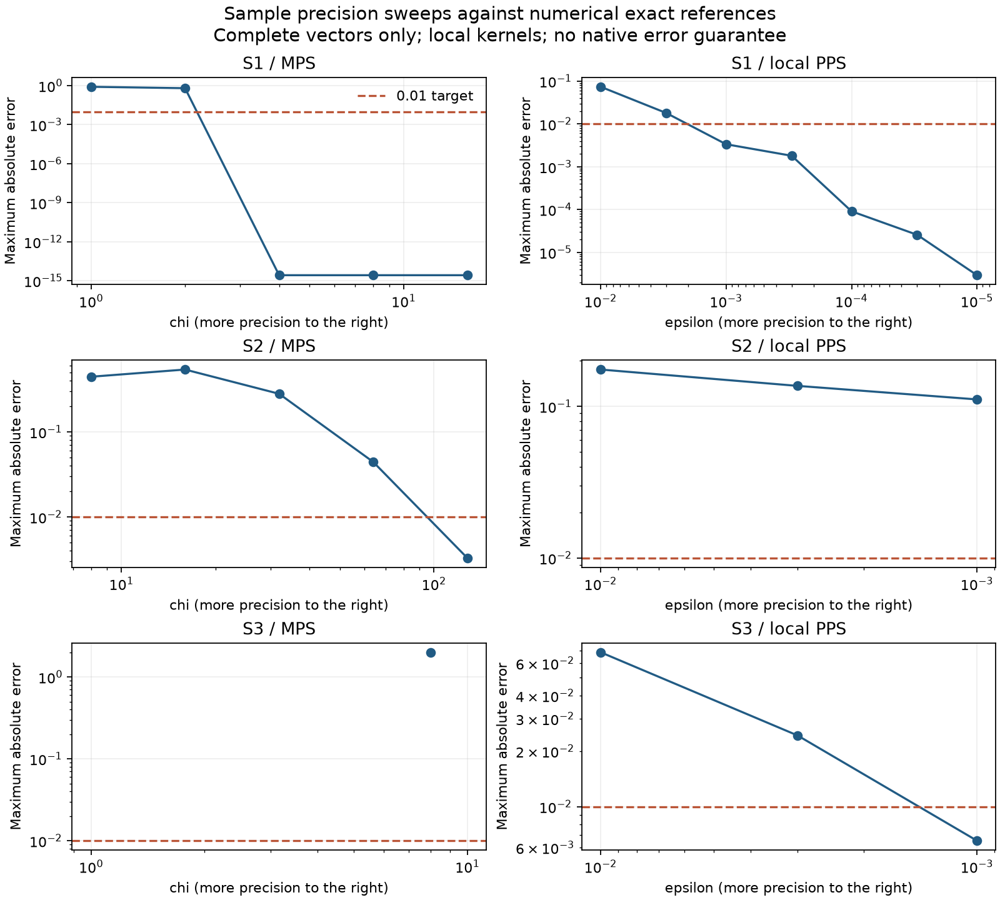

# Sample calibration and final allocation

Generated: 2026-10-24T16:53:12.211876+00:00

Release status: **READY**. Numerical exact references: **50/50**.

Official submitted scores: S1 100/100, S2 100/100, S3 100/100 (displayed values; may round). The official S1/S2 submissions used exact local values; S3 used PPS epsilon 0.01. No extra score-testing submissions were made.

## Selected local settings

| Sample | Method | Parameters | Max absolute error | Offline score / 100 | Vector wall seconds |
| --- | --- | --- | ---: | ---: | ---: |
| S1 | mps | `{"chi": 8, "svd_cutoff": 0.0}` | 2.66454e-15 | 100.00000000 | 10.45 |
| S2 | mps | `{"chi": 128, "svd_cutoff": 0.0}` | 0.00329332 | 99.99933880 | 186.86 |
| S3 | pps_threshold | `{"epsilon": 0.001, "level": 1}` | 0.00653127 | 99.99875390 | 123.23 |

Acceptance requires maximum absolute error <= 0.01 and offline score >= 99. Timings are observed single-run totals, not a statistically established optimum. The settings describe local implementations; native transfer remains unverified.

## What changed because of the evidence

- S2: chi 64 missed the absolute-error target; chi 128 reduced worst error to about 0.0033. However, native G2 chi128 quotes exceed the budget/runtime allocation. The graded baseline uses affordable PPS .001 pilots (S2 max error about 0.111), with chi16 independent checks. This quality compromise is explicit.
- S3: the officially submitted coarse vector displayed 100/100 but had material pointwise error. The complete epsilon sweep is checked against all exact CPU references. Tighter epsilon 0.0001 hit the 100,000-term cap on two IDs; those incomplete runs were never accepted as values.
- G1: reuse a teammate's 30 exact CPU outputs, matched against his submitted CSV and source job ledger. No repeat simulation is scheduled. Larger G2-G4 CPU and exact-GPU requests were rejected for size.
- G4: no sample matches its Haar-grid family. Chi64 native CPU/GPU quotes were too costly/slow. Use PPS .001 pilots plus MPS chi16, requiring a resolved pilot signal and an independent result before bulk coverage. These are engineering priors, not validated G4 settings.
- Fusion and extrapolation are disabled. Within-method signed trends, contraction and oscillation affect refinement priority alongside cross-method differences. Official scores reweight whole-problem effort only. No diagnostic certifies an error bound.
- The original MPS norm guard incorrectly rejected a small finite norm. Explicit rescaling repaired the operational issue; its failed attempt is preserved and excluded from calibration retries.

## Complete benchmark vectors

| Problem | Method / precision | Offline score | Max error | Wall seconds |
| --- | --- | ---: | ---: | ---: |
| S1 | exact `{"precision": "double", "result_zero_threshold": 0.0, "shots": null}` | 100.00000000 | 0 | 20.36 |
| S1 | mps `{"chi": 1, "svd_cutoff": 0.0}` | 0.00000000 | 0.810347 | 28.92 |
| S1 | mps `{"chi": 16, "svd_cutoff": 0.0}` | 100.00000000 | 2.66454e-15 | 15.28 |
| S1 | mps `{"chi": 2, "svd_cutoff": 0.0}` | 70.22360168 | 0.632109 | 10.50 |
| S1 | mps `{"chi": 4, "svd_cutoff": 0.0}` | 100.00000000 | 2.66454e-15 | 10.48 |
| S1 | mps `{"chi": 8, "svd_cutoff": 0.0}` | 100.00000000 | 2.66454e-15 | 10.45 |
| S1 | pps_threshold `{"epsilon": 0.0001, "level": 1}` | 99.99999540 | 9.08858e-05 | 11.06 |
| S1 | pps_threshold `{"epsilon": 0.0003, "level": 1}` | 99.99883020 | 0.00180378 | 10.92 |
| S1 | pps_threshold `{"epsilon": 0.001, "level": 1}` | 99.99415455 | 0.0033527 | 10.58 |
| S1 | pps_threshold `{"epsilon": 0.003, "level": 1}` | 99.93075211 | 0.0179843 | 10.81 |
| S1 | pps_threshold `{"epsilon": 0.01, "level": 1}` | 99.67522827 | 0.073748 | 10.77 |
| S1 | pps_threshold `{"epsilon": 1e-05, "level": 1}` | 99.99999999 | 2.92695e-06 | 13.59 |
| S1 | pps_threshold `{"epsilon": 3e-05, "level": 1}` | 99.99999973 | 2.57007e-05 | 13.06 |
| S2 | exact `{"precision": "double", "result_zero_threshold": 0.0, "shots": null}` | 100.00000000 | 0 | 52.31 |
| S2 | mps `{"chi": 128, "svd_cutoff": 0.0}` | 99.99933880 | 0.00329332 | 186.86 |
| S2 | mps `{"chi": 16, "svd_cutoff": 0.0}` | 84.41172862 | 0.541668 | 53.55 |
| S2 | mps `{"chi": 32, "svd_cutoff": 0.0}` | 95.79620366 | 0.280771 | 65.69 |
| S2 | mps `{"chi": 64, "svd_cutoff": 0.0}` | 99.86264180 | 0.0443642 | 93.08 |
| S2 | mps `{"chi": 8, "svd_cutoff": 0.0}` | 81.43580557 | 0.445703 | 66.97 |
| S2 | pps_threshold `{"epsilon": 0.001, "level": 1}` | 98.79050523 | 0.111276 | 88.42 |
| S2 | pps_threshold `{"epsilon": 0.003, "level": 1}` | 98.24729960 | 0.136709 | 45.75 |
| S2 | pps_threshold `{"epsilon": 0.01, "level": 1}` | 97.34571501 | 0.175219 | 56.32 |
| S3 | exact `{"precision": "cloud_cpu", "shots": null}` | 100.00000000 | 0 | 1644.68 |
| S3 | mps `{"chi": 8, "svd_cutoff": 0.0}` | 0.00000000 | 2 | 151.64 |
| S3 | pps_threshold `{"epsilon": 0.001, "level": 1}` | 99.99875390 | 0.00653127 | 123.23 |
| S3 | pps_threshold `{"epsilon": 0.003, "level": 1}` | 99.97112534 | 0.0243321 | 94.93 |
| S3 | pps_threshold `{"epsilon": 0.01, "level": 1}` | 99.79705723 | 0.0687144 | 109.94 |

## Stopping replay

- S1: EVALUATED; 15 complete prefix pairs, 8 candidate per-ID stops, 0 false stops against the 0.01 error target.
- S2: EVALUATED; 3 complete prefix pairs, 0 candidate per-ID stops, 0 false stops against the 0.01 error target.
- S3: INSUFFICIENT_COMPLETE_HISTORIES; 0 complete prefix pairs, 0 candidate per-ID stops, 0 false stops against the 0.01 error target.

No universal native stopping guarantee follows from these samples. The raw replay includes every complete earlier precision prefix, so an early shared bias cannot be hidden by a good final answer.

## Audit and costs

Recorded execution attempts: **443**; states: `{'COMPLETED': 80, 'FAILED': 11, 'SUCCEEDED': 350, 'INCOMPLETE': 2}`.

Every observed sample cloud job cost $0. Independent native MPS/PPS sample quotes of $0.20 were blocked. Graded quotation is not simulation or spending. The $30 balance is reserved for graded work; automatic planned spend is limited to $25.50, plus protection for remaining baseline coverage.

See [runs/jobs.csv](../runs/jobs.csv), [runs/decisions.csv](../runs/decisions.csv), [runs/submissions.csv](../runs/submissions.csv), and [docs/history/workflow_final_graded.md](../docs/history/workflow_final_graded.md). The cleanup inventory records the recovery commit for removed obsolete files.

