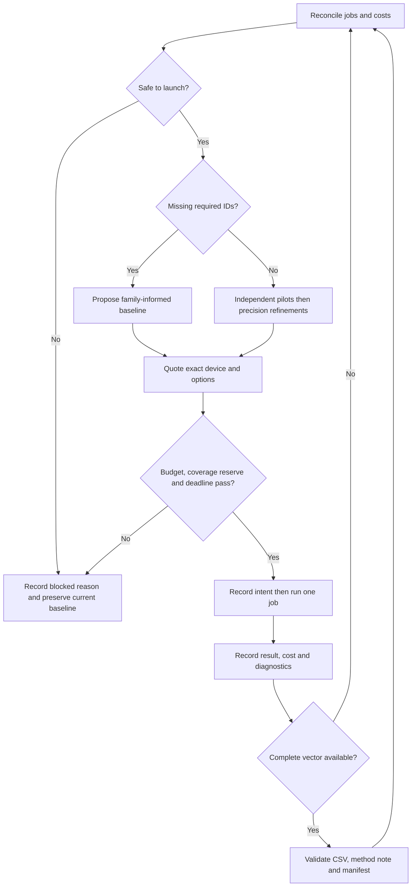

# Final graded-submission workflow

The executable policy is [configs/workflow_final.json](configs/workflow_final.json). The measured evidence is in [reports/calibration_evidence.json](reports/calibration_evidence.json), [reports/sample_benchmarks.json](reports/sample_benchmarks.json), and [runs/](runs/README.md). This supersedes the proposals retained in [docs/history/](docs/history/).

## What the sample work establishes

**G1 is already solved by Kevin.** The 30 values in [problems/04_graded_G1/exact_values.csv](problems/04_graded_G1/exact_values.csv) match his submitted file and all 30 completed exact CPU jobs in `kevin/experiment` at commit `9714dab3422134c77b7fc36f99e86f5f2dada921`. The ledger reports $0 for each successful job, and Kevin reports a 100% score. The workflow imports this exact anchor and schedules no duplicate G1 work. Its reported score is distinguished from our independently observed sample scores; his historical job costs are not charges against our current API account.

All three official sample submissions display **100/100**, with one attempt used per problem. S1 and S2 were submitted from local exact statevectors; S3 was submitted from the independent local coefficient-cutoff Pauli engine at epsilon 0.01. The exact uploaded bytes, explanations, scores and supporting execution IDs are in [submissions/](submissions/README.md).

Official scores are correlation-based and the UI rounds them. A score of 100 does not establish small pointwise error. We separately compare every complete precision vector with numerical exact references: local Aer for S1/S2, and free BlueQubit CPU jobs for all S3 IDs. The calibration acceptance gate is **maximum absolute error <= 0.01 and offline correlation score >= 99/100**. These are chosen engineering targets, not organizer requirements or statistical confidence limits.

The sample-informed allocation is:

| Graded problem | Starting method | Rationale and limitation |
| --- | --- | --- |
| G1, 30-qubit Haar chain | Reuse Kevin's completed exact CPU vector | All 30 values match the source ledger and main's retained CSV. No repeat runs. Free exact CPU remains the fallback only if this anchor is unavailable. |
| G2, 36-qubit Haar chain | Affordable PPS epsilon 0.001 pilots; MPS chi 16 independent checks | S2 prefers MPS chi 128 for accuracy, but the native quote is $3.02 and 7,230 seconds per ID. The feasible PPS fallback is a deliberate quality compromise: its S2 max error is about 0.111. |
| G3, 36-qubit mostly-Clifford grid | PPS at the S3-selected threshold | S3 favors Pauli propagation. Smaller thresholds can exceed the local term cap, so smaller is not automatically better operationally. |
| G4, 38-qubit Haar grid | PPS epsilon 0.001 pilots and MPS chi 16 independent checks | No matching sample family exists. Native MPS chi 64 quotes exceed this allocation on both CPU and GPU. These affordable starting settings remain unvalidated for G4. |

Local Quimb MPS and our coefficient-cutoff Pauli implementation are **different implementations** from BlueQubit's native kernels. Native MPS/PPS sample quotes were $0.20, so they were not executed under the user's $0 sample limit. Local calibration provides starting choices, not native error guarantees. Native PPS transpilation level 2 is used; local Qiskit optimization level 1 is not an equivalent transformation. Thresholds below 1e-5 are never sent to the native PPS service.

## Decision loop

**Native campaign update (October 24):** The starting PPS 0.001 pilot vectors
were zero for G2, G3 and G4. G2 q0 changed to 0.045096 at 0.0001, so a zero
plateau is not evidence of convergence. The active planner now implements the
original proposal's independent-pilot recovery, measured-runtime scheduling,
and complete-vector shape sensitivity. See
[reports/GRADED_CAMPAIGN.md](reports/GRADED_CAMPAIGN.md) for evidence and limits.
It switches away from a flat primary only when every independent pilot is
available at one identical configuration and that vector resolves a signal.
This selects an uncertified direct baseline, not an exact answer.

Scheduling time is at least the observed upper-quartile wall time for the
problem/device, even when the quote is unrealistically short. For complete
successive vectors at a fixed device and transpilation setting, squared
residuals after affine alignment boost refinement priorities for rows that
change vector shape. Neither diagnostic changes raw submission values or
certifies error. Extrapolation and fusion still require held-out validation.

1. **Reconcile before spending.** Read account jobs, known costs, unresolved jobs, the stop flag and the deadline. Unknown charges, active jobs or ambiguous submissions block a new cloud launch. Read each ID's existing receipts before proposing another action.
2. **Pilot, then complete baseline coverage.** For approximate methods, first obtain the three configured pilot IDs. A nearly constant pilot vector blocks bulk coverage and directs effort to refinement/review; it does not prove that the method is wrong. G4 additionally requires one completed independent-method pilot before bulk coverage. Then obtain one genuine direct result for each required ID. Each ID is a separate program; no result is reused as another ID's answer. G1 tries free exact CPU first. Failed actions are retained and not blindly repeated; an unattempted method can supply a fallback.
3. **Quote the exact proposed precision.** The SDK's estimate-only route receives the same device, Pauli and precision options as execution. The quote is recorded. A new quote and budget check occur immediately before submission. Quotes are estimates, not service-enforced dollar caps.
4. **Protect the budget and time.** Sample spend remains $0. The graded budget is $30, with 15% ($4.50) held in reserve, so automated planned spending stops at $25.50. An additional $0.20 per still-missing G2-G4 row is protected for estimated baseline coverage. This is a planning allowance, not a guaranteed price; actual quotes can block a plan. A 600-second cloud job limit, one active cloud job, an 800-job cap and a 20-minute submission buffer apply. Unknown or excessive runtime is blocked.
5. **Allocate remaining effort.** Missing rows dominate priority after the pilot gate; the required G4 independent pilot has coverage priority. Among comparable candidates, priority uses problem points per required row, observed precision/cross-method sensitivity, quoted cost, and quoted runtime. Cost plus runtime/3600 is a scheduling heuristic, not expected score gain. Candidates are quoted across problems so one instance cannot hide the alternatives. Further independent-method pilots on the first, butterfly/central and last qubits precede ordinary refinements. Increase MPS chi up to 512; decrease PPS along the configured grid, never below 1e-5.
6. **Choose direct outputs.** Exact CPU wins when available. Otherwise take the highest completed precision in the family-selected method; use an available fallback only when the primary is unavailable, and record that reason. Do not assume higher precision improves every individual estimate. Fusion and extrapolation stay disabled: we have insufficient evidence for reliable native transfer or G4-family improvement.
7. **Export only a complete vector.** Validate IDs, finite values and row count against the retained released template. Protect the first complete baseline atomically. Export a CSV, mandatory method explanation and per-ID job/parameter manifest. Exporting is not submitting.
8. **Submit and record the actual outcome.** Upload the CSV and its method explanation; verify the website's attempt number and displayed score. Record those observed facts with `record_submission.py`. Preserve every submitted version. Never fit hidden labels or check the scorer.

To minimize time penalties, export each problem immediately when it has a complete usable vector, and submit that genuine baseline before pursuing further refinements. G1 can be submitted from the retained exact file now. Later official scores reweight **whole-problem effort** by remaining score headroom, with a floor because the display rounds; they never determine individual output values. Preserve the best submitted result while testing new genuine simulator configurations. The scheduler's objective is a transparent heuristic, not a proven optimum for the leaderboard.

### CPU/GPU choice

For native MPS and PPS candidates, the planner can compare CPU and GPU routes at the same precision. It chooses the lowest quoted cost among feasible routes, then the shorter runtime in a price tie. It checks the 7.5-hour total GPU allowance and 45-minute rolling-hour allowance from account job times, plus the per-job and dollar limits. Unknown GPU usage blocks GPU work. Planning may reuse a quote for at most five minutes to reduce overhead; execution always re-quotes. Current exact-GPU requests for G2/G3 (36 qubits) and G4 (38 qubits) were explicitly rejected for size, so GPU statevector is not an exact shortcut for these instances. GPU remains available when the requested mode and size are supported and its fresh quote passes the gates.

Kevin's source ledger also records rejected attempts from exceeding the five-job account limit. We preserve those failures and keep this budgeted executor serial. Reusing G1 avoids the much larger time cost of repeating that solved problem; no claim is made that serial scheduling maximizes throughput.



## Stopping: what is and is not established

**Within-method trends matter independently of cross-method disagreement.** `trend_diagnostic` records signed changes, slopes per logarithmic precision increment, sign reversals, contraction ratios and flat segments. An oscillating or growing sequence raises refinement priority. A consistently contracting sequence can supply a geometric tail *proxy* for scheduling; it never changes the submitted estimate or becomes a certified error bar. A flat sequence is labelled `FLAT_UNVERIFIED`, since both algorithms can plateau at a biased value or PPS can drop every term. See [reports/trend_evidence.json](reports/trend_evidence.json) for the sample histories. Missing independent-method runs do not prevent useful within-method refinement.

The engineering diagnostic requires at least three distinct precision levels in **each** branch, two consecutive small changes in each, small MPS/PPS disagreement, and resolved, stable vector shape. For a problem's robust signal scale `s`, the pointwise tolerance is `min(0.001, 0.03 * max(s, 0.02))`; shape change must be <= 0.001. Near-constant vectors below centered RMS 1e-4 cannot pass the shape check.

Calibration replays **every complete coarse-to-fine prefix pair**, including early plateaus, and compares proposed stops with exact reference errors. It does not check only the final best estimates. The results are in the calibration evidence. The three samples do not establish a universal stopping guarantee, and native transfer has not been validated. Therefore **automatic convergence stopping on graded IDs is disabled**. These diagnostics inform priority and review; exact completion, configured resource bounds, deadline or budget decide when automated work stops. A budget-limited answer remains explicitly unverified.

This avoids spending six or more runs per hidden observable merely to claim two-method convergence: even at $0.20 per run that would exceed the available budget. Baseline coverage and honest uncertainty take precedence over a claim the evidence cannot support.

## Operation and recovery

Run from the repository root in Python 3.12:

```powershell
.venv312\Scripts\python.exe scripts/smoke_test.py
.venv312\Scripts\python.exe -m unittest discover -s tests
.venv312\Scripts\python.exe scripts/sync_runs.py
.venv312\Scripts\python.exe scripts/run_workflow.py tune
.venv312\Scripts\python.exe scripts/graded_workflow.py
```

The last command obtains quotes and writes a reviewable plan; it does not simulate. Once calibration has `release_status: READY`, execution is explicit and serial:

For a network-free review using saved quotes and job receipts, use `scripts/graded_workflow.py --offline-plan`. Offline quotes can never authorize execution.

```powershell
.venv312\Scripts\python.exe scripts/graded_workflow.py --execute --max-jobs 1
```

Increase `--max-jobs` only for an intended bounded batch. Every action is re-evaluated after the preceding job. Never launch a second cloud runner. A `results/workflow/STOP` file blocks new launches and requests cancellation of an active polled job; cancellation does not prove zero cost. Reconcile its terminal job and actual cost before removing the flag. A saved SUBMITTING action without a job ID requires matching it to the service's job history before any retry; do not delete its receipt to force resubmission.

If an exact quote changes to a paid or excessive-runtime plan, G1 falls back to a quoted MPS action, still subject to the same gates. Live representative G2-G4 CPU exact quotes reject circuits over 34 qubits. G2 MPS chi 128 was quoted at $3.02/7,230 seconds on CPU and $3.14/2,825 seconds on GPU; G4 MPS chi 64 at $0.79/1,878 seconds on CPU and $1.08/968 seconds on GPU. All exceed the selected 600-second job limit. PPS epsilon 0.001 and MPS chi 16 were quoted at $0.20 for their representative IDs. Those are dated, nonbinding quotes, preserved in [reports/native_quotes.json](reports/native_quotes.json), and may differ for other IDs. If prices exceed the coverage allowance, the planner blocks rather than spending the reserve. A network error, timeout or quota error is not permission to launch a duplicate.

To record a verified website submission:

```powershell
.venv312\Scripts\python.exe scripts/record_submission.py --problem G1 --attempt 1 --csv PATH_TO_UPLOADED.csv --note-file PATH_TO_EXPLANATION.txt --score OBSERVED_SCORE
```

The description must name the actual method and precision used, qubit ordering and any approximation/fusion. The recorder requires a nonempty explanation and a supporting execution for every uploaded value. Scores are manually observed website facts, never invented by the exporter. The usage heartbeat and per-job account queries monitor spending; the ledger records the decisions independently of that monitor.
